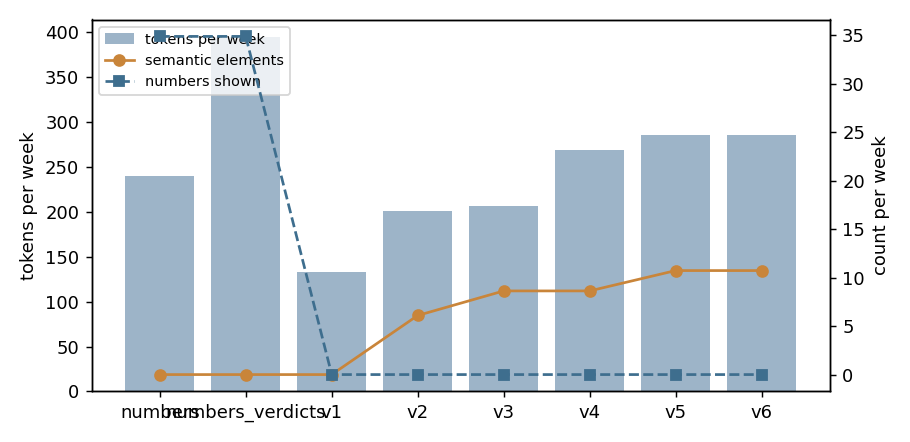
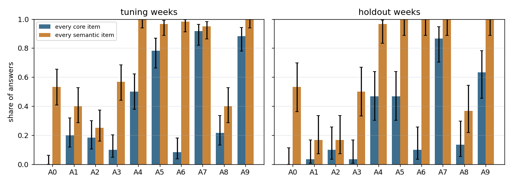
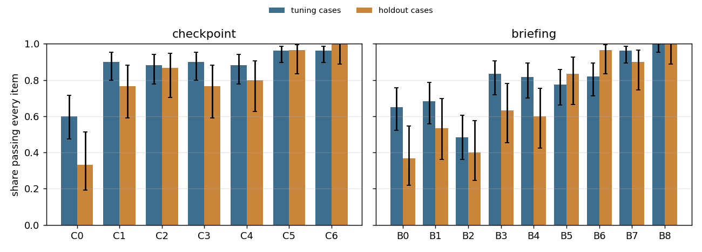

# Words, not numbers: label engineering for a small local language model writing weekly fitness reviews

*Working report, generated 2026-10-12 10:10 from code at `ce0b843` + uncommitted changes by `python -m evals.report`. Rubric core-v2.1 (2026-10-04); tokens counted with cl100k_base. Change the narrative in `evals/attempts.py`; every number is recomputed.*

## 1. Question

Can a small local language model (qwen3:8b, 4-bit, on an 8 GB consumer GPU) write a reliable weekly fitness review if deterministic code first turns the week's numbers into words (labels), and how far should that go: verdicts only, or also meaning, priorities and the shape of the answer?

**At a glance.** Share of answers passing every item of the core rubric v2, and every semantic item, per approach (current versions, all runs pooled; ⚠ = an older run until the current version has been run).

| id | approach | holdout: every core item | holdout: every semantic item | tuning: every core item | tuning: every semantic item | s / review | redrafted (holdout) |
|---|---|---|---|---|---|---|---|
| A0 | old single prompt (thinking) | 0% | 53% | 0% | 53% | 39.6 | 67% |
| A1 | numbers, two questions | 3% | 17% | 20% | 40% | 7.4 | 43% |
| A2 | labels v1 | 10% | 17% | 18% | 25% | 5.7 | 33% |
| A3 | labels v2 | 3% | 50% | 10% | 57% | 6.1 | 50% |
| A4 | labels v3 | 47% | 97% | 50% | 100% | 6.7 | 63% |
| A5 | labels v4 | 47% | 100% | 78% | 97% | 6.1 | 53% |
| A6 | labels v5 | 10% | 100% | 8% | 98% | 6.3 | 100% |
| A7 | labels v6 | 87% | 100% | 92% | 95% | 5.2 | 33% |
| A8 | numbers + v1 verdicts (ablation) | 13% | 37% | 22% | 40% | 7.8 | 63% |
| A9 | labels v6 + figures (ablation) | 63% | 100% | 88% | 100% | 6.3 | 50% |

**What the attempts taught so far** (each point refers to the tables in section 5):

- The numeric prompt stated a verdict for only two of three metrics (verdict coverage 66%, section 5.1), and the model inferred the missing one wrongly ('2650 kcal, slightly below the 2000 kcal target'). Stating every comparison in words removed that class of error (hallucination column, A1 vs A2, section 5.2).
- Words alone did not make the advice right: with labels v1 the semantic pass rate stayed as low as with numbers (section 5.2). The model could read where each metric sat but not what it meant for the goal.
- Meaning is what made the advice right. Labels that say what a gap does to this phase's goal, whether a trend moves toward or away from the target, which links are real, what matters most and what kind of fix fits (v3) raised the semantic pass rate to nearly every answer, on the untouched holdout weeks as well (sections 5.2, 5.5).
- More information can hurt when it reads like an item to act on. v2's 'keep as they are' list became wasted 'keep X as it is' recommendations (sections 5.2, 5.4).
- Show each question only what it needs. One view per question (v4) shortened the prompts and cut the directives (section 5.1) and stopped the observations drifting into advice (instruction column, section 5.2).
- The model copies the structure of its instructions. A plan listed as 'Recommendation one: ...' came back in that format instead of numbered (v5); the same plan as one sentence (v6) kept the benefit and fixed the format.
- Each decision moved out of the model and into deterministic code (the verdicts, their meaning, the priority order, how many recommendations and what each is for) made the answers more correct; what is left to the model is the wording.
- Thinking is not a substitute for representation: the single thinking prompt (A0) was the slowest, failed the format, and was less often right than any meaning-bearing label version (section 5.2).
- Measure meaning, not only form. A format-and-hallucination checklist ranked v3 below v1 while blind reading preferred v3 in all ten holdout weeks; a semantic checklist, validated by reading what it flags (section 5.7), agreed with that reading (section 5.6).

## 2. System, model and data

CALVIS is a personal fitness assistant on Telegram. Once a week it writes a two-paragraph review: observations about the week (steps, calories, protein, workouts against the user's goals), then one to three numbered, concrete recommendations. Everything runs locally: qwen3:8b through Ollama in fast (non-thinking) mode unless stated, on an RTX 4060 with 8 GB. A review is two calls to the model (one per paragraph); a deterministic check after each call can send the draft back once with the problems named (a 'redraft').

Thirty synthetic weeks, each the exact dictionary the production code builds from the database (averages, day-to-day variability, daily slope, goals, workouts, peak step hour, days within ten kcal of the calorie target). Twenty TUNING weeks (evals/weekly_cases.py) cover the situations where a small model goes wrong: a met target it must not ask to increase, far-off targets, no workouts, a metric with no data, erratic days, each phase. Ten HOLDOUT weeks (evals/weekly_holdout_cases.py) were written later as different situations (eight of ten are verdict combinations the tuning weeks lack) and are never used to tune anything.

## 3. Attempts

| id | setup | date | attempt | representation |
|---|---|---|---|---|
| A0 | `old_think` | before 2026-10-04 | One big prompt (thinking) | numbers |
| A1 | `split_fast` | 2026-10-04 00:20-00:48 | Two focused questions (numbers) | numbers |
| A2 | `labels_fast` | 2026-10-04 02:55 | Labels v1: verdicts as words | labels_v1 |
| A3 | `labels2_fast` | 2026-10-04 03:11 | Labels v2: size, direction, goal | labels_v2 |
| A4 | `labels3_fast` | 2026-10-04 03:22 | Labels v3: meaning | labels_v3 |
| A5 | `labels4_fast` | 2026-10-04 03:59 | Labels v4: one view per question | labels_v4 |
| A6 | `labels5_fast` | 2026-10-04 04:03 | Labels v5: code decides the plan | labels_v5 |
| A7 | `labels6_fast` | 2026-10-04 04:58 | Labels v6: the plan as a sentence | labels_v6 |
| A8 | `hybrid_fast` | 2026-10-05 (run 2026-10-04 11:56-12:11) | Ablation: numbers plus v1's verdicts | numbers_verdicts |
| A9 | `matched6_fast` | 2026-10-12 | Ablation: labels v6 plus the figures (information-matched numeric) | numbers |

**A0 · One big prompt (thinking).** *What changed:* The original design: the week as numbers (averages, CV%, slopes, a 'Vs targets' line for steps and protein) and ONE prompt asking the model to reason in three internal stages and write both paragraphs; thinking mode; one redraft if a number is not in the data. *Why:* Baseline. *What happened:* Slow (about thirty seconds a review), recommendations often unnumbered prose, correlations invented between the time of day, workouts and eating. Its content was often on the right side (a food fix for a calorie problem), which the semantic items credit.

**A1 · Two focused questions (numbers).** *What changed:* Two smaller questions (observations; then recommendations, shown the observations) in fast mode, each with its own number check and one redraft. The checks were then corrected: magnitudes compared without sign, targets in the header counted as data, '2,200' read as one number, proposals such as '20 minutes' allowed in recommendations, the direction check applied to recommendations only. *Why:* A small model drops numbers and contradicts targets when asked for everything at once. *What happened:* Format and speed improved. Two failures remained that the checks could not see: the model called 2650 kcal 'slightly below' a 2000 kcal target (the numbers block gave a verdict line for steps and protein but none for calories), and it copied the prompt's example habit ('20-minute walk after dinner') into 18 of 20 answers.

**A2 · Labels v1: verdicts as words.** *What changed:* Deterministic code (weekly_labels.py) turns every number into words before the model sees anything: each average as its position against the goal ('a little below the goal'), the trend, the day-to-day consistency, workouts, the active time of day, a 'needs attention / on track' list. No digit reaches the model. Checks: no digits in observations, no invented figures, no contradiction of a verdict (calories included), every off-target metric addressed. *Why:* The user's principle: a small model reasons well over text and badly over numbers, so numbers go to deterministic functions that produce labels, and the model reasons over the labels. *What happened:* The calorie-direction errors and the parroted example disappeared; it won 15 of 20 blind comparisons against A1 and A0. Remaining: it ignored 'no workouts', invented links between metrics, read 'calorie target reached: never' as 'under target' (wording fixed the same night), and invented generic habits for a good week.

**A3 · Labels v2: size, direction, goal.** *What changed:* v1 plus the size of each gap in words, the direction to move ('eat less'), a 'keep as they are, do not ask for more' list, an 'advice goal' line, no workouts as a problem, and several wordings per verdict. *Why:* v1's failures were things the labels did not say. *What happened:* Advice targeted the right metric more often, but the keep-as-is list made the model spend a recommendation slot on 'keep calories exactly as they are' in about half the answers, so specificity and format scores fell. More information is not automatically better.

**A4 · Labels v3: meaning.** *What changed:* Labels that carry meaning, not only position: what each gap does to this phase's goal (calories over in a cut erase the deficit; in a bulk they add fat), whether each trend moves toward or away from the target, the only links between metrics that follow from the verdicts, priorities weighted by phase (under-eating outranks under-moving), the kind of fix (food / movement / training; a protein swap vs more food), and what to keep an eye on (drifting or erratic). Guards: recommendation one must take the first priority; a keep-only recommendation is redrafted; 'should' in the observations is redrafted. *Why:* A judge reading v1/v2 answers saw that the advice could not weigh a problem it did not understand. *What happened:* Best substance so far: it won all ten blind holdout comparisons against v1 and passed nearly every semantic item. Its observations degraded: advice wording ('focus on'), a meaning attached to the wrong metric ('protein was under, which means less movement'), headline copied verbatim.

**A5 · Labels v4: one view per question.** *What changed:* The same verdicts and meanings as v3, presented as two views: the observations question sees what happened and what it means (each meaning inline in its metric's sentence, nothing that asks for action, an explicit ban when no link exists); the recommendations question sees what to work on, in order, with the kind of fix, and what to leave unchanged as a constraint. The observations guard covers all advice wording. *Why:* v3's observations were shown priorities and fixes and drifted into advice; separate 'What it means' sentences drifted to the wrong metric. *What happened:* See the tables. In a first check on the holdout weeks the observations stopped giving advice and every semantic item passed, but the model still padded single-problem weeks with a 'keep X as it is' recommendation.

**A6 · Labels v5: code decides the plan.** *What changed:* v4 plus one change: code decides how many recommendations to write and what each one is for (one per priority, at most three, never fewer than two: a single problem gets two different habits; a quiet week gets protect-the-routine and guard-against). A wrong count is redrafted. *Why:* With one problem the model filled three slots by padding (v3 tuning answers 4/20, v4 holdout check 4/10). Another decision moved out of the model. *What happened:* The content followed the plan (the right habits, in priority order), but the plan was listed as 'Recommendation one: a habit for calories.' and the model copied that label format into its answer ('Recommendation one: Make a habit of ...') instead of numbering, so the count check redrafted nearly every answer and the numbered-format item failed: the model mirrors the structure of the instructions in its output.

**A7 · Labels v6: the plan as a sentence.** *What changed:* v5 with one change: the same plan is stated as one sentence ('exactly two recommendations, numbered 1. and 2. Plan them like this: the first is a habit for calories; the second ...'). Labels, views and checks are v5's. *Why:* v5's list format leaked into the answers. *What happened:* The plan's benefit stayed and the format failure disappeared: the best approach on every summary measure, on the holdout weeks as on the tuning weeks, with the fewest redrafts among the label versions after v1 and the shortest time per review.

**A8 · Ablation: numbers plus v1's verdicts.** *What changed:* A1's unchanged prompts and checks, with the numeric block kept in full and labels v1's verdict lines appended under 'use as-is'. The model sees every figure and every verdict, including the calorie verdict the numeric block lacked. *Why:* A2 changed two things at once: it removed the digits and it stated the missing calorie verdict. A8 vs A1 isolates complete verdicts; A8 vs A2 isolates the digits. *What happened:* Complete verdicts alone did almost nothing: A8 matches A1 on every item (22% vs 20% of tuning answers passing every item, 13% vs 3% on holdout weeks, both differences not significant) and its hallucination items stay at 77-78%, against 89-93% for A2. So the drop in hallucinations comes from removing the digits, not from the added verdict. Correct advice needed neither: the share of answers passing every semantic item stayed at 40% / 37%, like A1 (40% / 17%).

**A9 · Ablation: labels v6 plus the figures (information-matched numeric).** *What changed:* A7's description, priorities, kind of fix, links, one-sentence numbered plan and word limits, unchanged. The production numeric block is added under the description and the 'no digits' rules are replaced by 'use a figure from the figures above exactly as given'. The checks are A7's, with the no-digits check replaced by the figure check of the numeric designs. Scored with A7's checklist, minus the no-digits item. *Why:* A8 kept the digits but added only v1's verdicts, which carry no implications, priorities or plan. A reviewer's question: would a numeric prompt with the same implications, priorities and plan do as well? A9 vs A7 isolates the digits; A9 vs A1 isolates the implications, priorities and plan. *What happened:* The advice is as good as A7's: every semantic item passed in 100% of holdout and tuning answers (A7 100% / 95%, A1 17% / 40%), so implications, priorities and plan make the advice correct with or without the digits. The digits bring the factual errors back: invented figures in 23% of holdout answers (A7 0%, A1 30%) and 10% of tuning answers (A7 0%, A1 12%). Answers passing every core item: 63% on holdout weeks (A7 87%, A1 3%) and 88% on tuning weeks (A7 92%, A1 20%). On holdout weeks A9 vs A7 is -0.019 core items per week (0 better, 6 tied, 4 worse, p = 0.125), too few weeks to call; A9 vs A1 is +0.091 (10 better, p = 0.002). It is also slower than A7 (6.3 s against 5.2 s) and redrafts more often (50% against 33%).

## 4. Instruments

- **Rubric v1 (evals/weekly_rubric.py).** The first checklist, used for the ledger rows: hallucination, instruction following, coverage, specificity. Its label-mode variants differ slightly per approach, and it reuses the system's own guard functions, so rows are only roughly comparable.
- **Rubric v2, core (evals/rubric_v2.py).** The instrument used by this report: one fixed item set for every approach, self-contained (imports nothing from the system under test), with a semantic kind. Every saved answer is re-scored with it on each build. Each semantic item was validated by reading what it flagged on the saved answers; the false positives found are pinned by tests (tests/test_rubric_v2.py).
- **Blind judgments (evals/judgments.json).** Answers compared week by week with sides shuffled and the key opened after all picks. The judge is Claude in the working session, so judgments are a second opinion, not a human evaluation; the blind page (evals/blind_compare.py) lets the user judge.
- **Representation measures (evals/label_metrics.py).** Model-independent measures of what each approach shows the model: size, numeric content, statements, verdict coverage and fidelity, field resolution and capacity, discriminability, readability, redundancy, semantic elements, prompt load.
- **Output measures (evals/output_metrics.py).** From the saved answers: pass rates with 95% Wilson intervals, spread across repeats, redraft rate, latency, copy rate from the labels, lexical diversity, the most repeated recommendation phrase; paired per-week Wilcoxon comparisons between approaches.
- **Ledger (evals/ledger.md).** One row per evaluation run, appended automatically, plus the blind judgments: the chronological record.

**Rubric v2 items** (kind, item, definition):

- *hallucination* · `no_invented_numbers`: every figure about the week (>7) matches a data value or target within 2%; in the recommendations, proposals such as '20 minutes' or 'at least 30g' are allowed
- *hallucination* · `respects_target_status`: no recommendation moves a metric the wrong way: more steps/protein when already met, more calories when over, fewer when under (negations such as 'without adding' excluded)
- *hallucination* · `no_claims_without_data`: a metric with no data this week is not described
- *instruction* · `two_paragraphs`: exactly two paragraphs (observations, recommendations)
- *instruction* · `no_markdown`: no markdown syntax
- *instruction* · `no_label_or_heading`: no 'Observations:'-style label or heading
- *instruction* · `no_greeting`: does not open with a greeting
- *instruction* · `no_sign_off`: does not close with a sign-off
- *instruction* · `about_four_lines_each`: each paragraph 150-700 characters
- *instruction* · `observations_hold_no_advice`: the observations paragraph contains no advice wording
- *instruction* · `one_to_three_numbered_recommendations`: 1-3 recommendations numbered from 1
- *coverage* · `observations_cover_each_metric`: the observations discuss every metric that has data
- *coverage* · `recommendations_address_every_off_target_metric`: every off-target metric is named in the recommendations
- *specificity* · `every_recommendation_is_concrete`: each recommendation names an amount, time, place or habit
- *specificity* · `no_filler_phrases`: no filler such as 'stay consistent' or 'keep up the good work'
- *specificity* · `no_keep_only_recommendation`: no recommendation slot is spent only on keeping something as it is
- *semantic* · `fix_matches_problem`: each problem gets an action of the matching kind: calories over -> eat less (a food change, not exercise); calories under -> eat more; protein short -> a protein food; steps short -> more movement; no workouts -> a training session
- *semantic* · `first_recommendation_targets_a_problem`: when something is off target, recommendation 1 addresses a problem
- *semantic* · `large_calorie_gap_first`: when calories are off by 15% or more, recommendation 1 is a calorie (food) change
- *semantic* · `no_extra_movement_while_underfed`: when calories are under target, no added-movement recommendation comes before a food recommendation (more movement would deepen the deficit)
- *semantic* · `no_unsupported_link`: the observations claim no connection the data cannot support: time of day or workouts linked to eating, or two metrics linked causally unless the link follows from their verdicts
- *semantic* · `consequence_matches_metric`: in the observations, a 'which means ...' consequence is attached to the metric it belongs to

**Representation measures:**

- `tokens`: tokens per week (tiktoken cl100k_base, a proxy: Qwen's own tokenizer is not available offline)
- `words`: words per week
- `numbers`: numeric tokens per week (any figure such as 2650, 18:00, 14.0%)
- `statements`: statements per week: lines and clauses split on . ; and newlines, with at least two words
- `verdict_coverage`: share of metrics with data whose status against its target is stated explicitly
- `verdict_fidelity`: share of stated verdicts that agree with the ground truth computed from the raw numbers (evals/rubric_v2.reference_state), over the 30 weeks and the random sweep
- `capacity_bits`: sum over the label's fields (per metric) of log2(distinct values the field takes) over a random sweep of 4000 synthetic weeks (seed 2026): how finely the words can describe a week. Raw numbers are continuous, so this does not apply to them
- `discriminability`: mean pairwise distance between the 30 weeks' texts (1 - Jaccard similarity of word trigrams)
- `flesch`: Flesch reading ease (higher = easier), sentences = lines and full stops
- `fk_grade`: Flesch-Kincaid grade level
- `redundancy`: share of repeated word trigrams within a week's text (1 - unique/total)
- `semantic_elements`: statements of meaning per week: phase consequences, trend-vs-target judgements, links, priorities, kinds of fix, watch items, constraints

**Output measures:**

- `all_items`: share of answers passing every applicable core item (rubric v2)
- `semantic_all`: share of answers passing every applicable semantic item
- `item_rate`: share of applicable (answer, item) pairs passed, per kind
- `redraft_rate`: share of answers where at least one part failed a guard and was redrafted
- `latency`: seconds per review (mean / median), local qwen3:8b on an RTX 4060
- `copy_rate`: share of the answer's word 4-grams copied verbatim from the representation it was shown
- `distinct3`: distinct word trigrams / all word trigrams across one run's answers (one pass over the weeks), averaged over runs; higher = less templated. Pooling more answers lowers it, so it is computed per run to keep approaches comparable
- `top_phrase`: share of answers containing the approach's most frequent recommendation 5-gram, and the phrase
- `obs_digits`: digits per observations paragraph

## 5. Results

### 5.1 What each approach shows the model (no model involved)



| representation | tokens | numbers | statements | verdict coverage | verdict fidelity (weeks / sweep) | capacity (bits) | discriminability | Flesch / grade | redundancy | semantic elements |
|---|---|---|---|---|---|---|---|---|---|---|
| numbers | 240 ± 20 | 34.9 ± 4.9 | 18.7 ± 1.0 | 66% | 100% / 100% | continuous | 0.25 | 95 / 1.6 | 0.02 | 0.0 ± 0.0 |
| numbers_verdicts | 394 ± 21 | 34.9 ± 4.9 | 33.7 ± 1.3 | 100% | 100% / 100% | continuous | 0.39 | 83 / 3.8 | 0.15 | 0.0 ± 0.0 |
| labels v1 | 133 ± 4 | 0.0 ± 0.0 | 14.9 ± 0.3 | 100% | 100% / 100% | 30.8 | 0.53 | 69 / 6.3 | 0.20 | 0.0 ± 0.0 |
| labels v2 | 201 ± 13 | 0.0 ± 0.0 | 19.1 ± 0.6 | 100% | 100% / 100% | 49.8 | 0.53 | 71 / 6.8 | 0.17 | 6.1 ± 1.0 |
| labels v3 | 207 ± 56 | 0.0 ± 0.0 | 17.2 ± 2.5 | 100% | 100% / 100% | 69.8 | 0.76 | 75 / 5.5 | 0.08 | 8.6 ± 3.4 |
| labels v4 | 269 ± 75 | 0.0 ± 0.0 | 17.7 ± 2.6 | 100% | 100% / 100% | 69.8 | 0.79 | 73 / 6.3 | 0.24 | 8.6 ± 3.4 |
| labels v5 | 285 ± 74 | 0.0 ± 0.0 | 19.8 ± 2.8 | 100% | 100% / 100% | 75.2 | 0.78 | 73 / 6.3 | 0.24 | 10.7 ± 3.6 |
| labels v6 | 285 ± 74 | 0.0 ± 0.0 | 19.8 ± 2.8 | 100% | 100% / 100% | 75.2 | 0.78 | 73 / 6.3 | 0.24 | 10.7 ± 3.6 |

Field resolution: distinct values each label field took over the random sweep (per-metric fields are written `metric.field`). The capacity column above is the sum of log2 of these counts.

| field | v1 | v2 | v3 | v4 | v5 | v6 |
|---|---|---|---|---|---|---|
| `steps.level` | 6 | – | – | – | – | – |
| `steps.trend` | 6 | 6 | – | – | – | – |
| `steps.consistency` | 5 | 5 | – | – | – | – |
| `calories.level` | 8 | – | – | – | – | – |
| `calories.trend` | 6 | 6 | – | – | – | – |
| `calories.consistency` | 5 | 5 | – | – | – | – |
| `protein.level` | 6 | – | – | – | – | – |
| `protein.trend` | 6 | 6 | – | – | – | – |
| `protein.consistency` | 5 | 5 | – | – | – | – |
| `workouts` | 8 | 8 | 8 | 8 | 8 | 8 |
| `goal_days` | 6 | 6 | 6 | 6 | 6 | 6 |
| `peak` | 5 | 5 | 5 | 5 | 5 | 5 |
| `steps.wording` | – | 6 | 6 | 6 | 6 | 6 |
| `steps.gap` | – | 8 | 10 | 10 | 10 | 10 |
| `steps.direction` | – | 3 | – | – | – | – |
| `calories.wording` | – | 8 | 8 | 8 | 8 | 8 |
| `calories.gap` | – | 7 | 9 | 9 | 9 | 9 |
| `calories.direction` | – | 4 | – | – | – | – |
| `protein.wording` | – | 6 | 6 | 6 | 6 | 6 |
| `protein.gap` | – | 8 | 10 | 10 | 10 | 10 |
| `protein.direction` | – | 3 | – | – | – | – |
| `priority_order` | – | 32 | 41 | 41 | 41 | 41 |
| `steps.severity` | – | – | 6 | 6 | 6 | 6 |
| `steps.trend_meaning` | – | – | 8 | 8 | 8 | 8 |
| `steps.consistency_meaning` | – | – | 3 | 3 | 3 | 3 |
| `steps.meaning` | – | – | 5 | 5 | 5 | 5 |
| `calories.severity` | – | – | 5 | 5 | 5 | 5 |
| `calories.trend_meaning` | – | – | 8 | 8 | 8 | 8 |
| `calories.consistency_meaning` | – | – | 4 | 4 | 4 | 4 |
| `calories.meaning` | – | – | 12 | 12 | 12 | 12 |
| `protein.severity` | – | – | 6 | 6 | 6 | 6 |
| `protein.trend_meaning` | – | – | 8 | 8 | 8 | 8 |
| `protein.consistency_meaning` | – | – | 3 | 3 | 3 | 3 |
| `protein.meaning` | – | – | 5 | 5 | 5 | 5 |
| `workout_meaning` | – | – | 5 | 5 | 5 | 5 |
| `links` | – | – | 10 | 10 | 10 | 10 |
| `watch` | – | – | 8 | 8 | 8 | 8 |
| `plan` | – | – | – | – | 44 | 44 |

Prompt load: the full prompts as sent, instructions included (mean over the 30 weeks).

| approach | observations prompt tokens | recommendations prompt tokens | directives per prompt | questions per review |
|---|---|---|---|---|
| old (A0) | 488 | – | 14.0 | 1 |
| numbers (A1) | 477 | 507 | 15.0 | 2 |
| numbers + verdicts (A8) | 630 | 660 | 17.6 | 2 |
| labels v1 | 333 | 362 | 15.5 | 2 |
| labels v2 | 421 | 467 | 18.4 | 2 |
| labels v3 | 466 | 530 | 21.1 | 2 |
| labels v4 | 389 | 395 | 16.6 | 2 |
| labels v5 | 389 | 392 | 16.6 | 2 |
| labels v6 | 389 | 398 | 16.6 | 2 |

### 5.2 Answers, scored with the core rubric v2



**Tuning weeks.** ⚠ marks an approach with no run at its current version yet (its latest older run is shown).

| id | approach | answers (weeks × runs) | every core item | every semantic item | halluc. | instruction | coverage | specificity | semantic | s / review |
|---|---|---|---|---|---|---|---|---|---|---|
| A0 | old single prompt (thinking) | 60 (20×3) | 0% [0%–6%] | 53% [41%–65%] | 87% | 88% | 100% | 65% | 87% | 33.4 |
| A1 | numbers, two questions | 60 (20×3) | 20% [12%–32%] | 40% [29%–53%] | 80% | 99% | 100% | 96% | 75% | 7.7 |
| A2 | labels v1 | 60 (20×3) | 18% [11%–30%] | 25% [16%–37%] | 93% | 100% | 100% | 89% | 77% | 5.5 |
| A3 | labels v2 | 60 (20×3) | 10% [5%–20%] | 57% [44%–68%] | 93% | 98% | 100% | 58% | 88% | 6.1 |
| A4 | labels v3 | 60 (20×3) | 50% [38%–62%] | 100% [94%–100%] | 93% | 98% | 100% | 83% | 100% | 5.7 |
| A5 | labels v4 | 60 (20×3) | 78% [66%–87%] | 97% [89%–99%] | 99% | 100% | 100% | 93% | 99% | 5.0 |
| A6 | labels v5 | 60 (20×3) | 8% [4%–18%] | 98% [91%–100%] | 97% | 89% | 100% | 71% | 100% | 5.7 |
| A7 | labels v6 | 60 (20×3) | 92% [82%–96%] | 95% [86%–98%] | 98% | 100% | 100% | 100% | 99% | 4.5 |
| A8 | numbers + v1 verdicts (ablation) | 60 (20×3) | 22% [13%–34%] | 40% [29%–53%] | 77% | 99% | 100% | 92% | 81% | 7.4 |
| A9 | labels v6 + figures (ablation) | 60 (20×3) | 88% [78%–94%] | 100% [94%–100%] | 92% | 100% | 100% | 100% | 100% | 5.5 |

**Holdout weeks.** ⚠ marks an approach with no run at its current version yet (its latest older run is shown).

| id | approach | answers (weeks × runs) | every core item | every semantic item | halluc. | instruction | coverage | specificity | semantic | s / review |
|---|---|---|---|---|---|---|---|---|---|---|
| A0 | old single prompt (thinking) | 30 (10×3) | 0% [0%–11%] | 53% [36%–70%] | 90% | 88% | 100% | 70% | 84% | 39.6 |
| A1 | numbers, two questions | 30 (10×3) | 3% [1%–17%] | 17% [7%–34%] | 73% | 100% | 100% | 94% | 64% | 7.4 |
| A2 | labels v1 | 30 (10×3) | 10% [3%–26%] | 17% [7%–34%] | 89% | 98% | 100% | 92% | 73% | 5.7 |
| A3 | labels v2 | 30 (10×3) | 3% [1%–17%] | 50% [33%–67%] | 94% | 95% | 100% | 66% | 86% | 6.1 |
| A4 | labels v3 | 30 (10×3) | 47% [30%–64%] | 97% [83%–99%] | 95% | 97% | 93% | 92% | 99% | 6.7 |
| A5 | labels v4 | 30 (10×3) | 47% [30%–64%] | 100% [89%–100%] | 98% | 100% | 95% | 77% | 100% | 6.1 |
| A6 | labels v5 | 30 (10×3) | 10% [3%–26%] | 100% [89%–100%] | 95% | 89% | 95% | 71% | 100% | 6.3 |
| A7 | labels v6 | 30 (10×3) | 87% [70%–95%] | 100% [89%–100%] | 100% | 100% | 95% | 99% | 100% | 5.2 |
| A8 | numbers + v1 verdicts (ablation) | 30 (10×3) | 13% [5%–30%] | 37% [22%–54%] | 78% | 98% | 100% | 96% | 73% | 7.8 |
| A9 | labels v6 + figures (ablation) | 30 (10×3) | 63% [46%–78%] | 100% [89%–100%] | 83% | 100% | 97% | 98% | 100% | 6.3 |

### 5.3 Behaviour

**Tuning weeks.**

| id | approach | every core item (mean ± sd over runs) | every semantic item (mean ± sd) | redrafted | calls | words obs / recs | digits in obs | copied from labels | distinct-3 | most repeated recommendation 5-gram |
|---|---|---|---|---|---|---|---|---|---|---|
| A0 | old single prompt (thinking) | 0.00 ± 0.00 | 0.53 ± 0.03 | 63% | 1.63 | 58 / 45 | 19.4 | 0% | 0.85 | 10% “to meet the g target” |
| A1 | numbers, two questions | 0.20 ± 0.05 | 0.40 ± 0.05 | 58% | 2.58 | 75 / 57 | 22.3 | 0% | 0.63 | 95% “minute walk after dinner to” |
| A2 | labels v1 | 0.18 ± 0.03 | 0.25 ± 0.00 | 27% | 2.27 | 74 / 66 | 0.0 | 6% | 0.64 | 60% “most active time of day” |
| A3 | labels v2 | 0.10 ± 0.09 | 0.57 ± 0.10 | 43% | 2.55 | 74 / 63 | 0.0 | 3% | 0.65 | 47% “in the early evening to” |
| A4 | labels v3 | 0.50 ± 0.09 | 1.00 ± 0.00 | 57% | 2.70 | 74 / 47 | 0.0 | 12% | 0.66 | 33% “add a minute walk in” |
| A5 | labels v4 | 0.78 ± 0.03 | 0.97 ± 0.03 | 28% | 2.32 | 67 / 52 | 0.0 | 10% | 0.70 | 27% “minute walk in the early” |
| A6 | labels v5 | 0.08 ± 0.03 | 0.98 ± 0.03 | 90% | 2.98 | 67 / 51 | 0.0 | 12% | 0.65 | 27% “in the early evening right” |
| A7 | labels v6 | 0.92 ± 0.03 | 0.95 ± 0.00 | 22% | 2.22 | 66 / 49 | 0.0 | 11% | 0.67 | 30% “set a reminder to take” |
| A8 | numbers + v1 verdicts (ablation) | 0.22 ± 0.06 | 0.40 ± 0.05 | 60% | 2.60 | 76 / 58 | 20.0 | 0% | 0.60 | 70% “minute walk after dinner to” |
| A9 | labels v6 + figures (ablation) | 0.88 ± 0.03 | 1.00 ± 0.00 | 48% | 2.57 | 68 / 46 | 10.0 | 0% | 0.68 | 20% “minute walk in the early” |

**Holdout weeks.**

| id | approach | every core item (mean ± sd over runs) | every semantic item (mean ± sd) | redrafted | calls | words obs / recs | digits in obs | copied from labels | distinct-3 | most repeated recommendation 5-gram |
|---|---|---|---|---|---|---|---|---|---|---|
| A0 | old single prompt (thinking) | 0.00 ± 0.00 | 0.53 ± 0.06 | 67% | 1.67 | 58 / 46 | 17.3 | 0% | 0.93 | 17% “to meet the g target” |
| A1 | numbers, two questions | 0.03 ± 0.06 | 0.17 ± 0.12 | 43% | 2.43 | 75 / 59 | 22.5 | 0% | 0.74 | 90% “minute walk after dinner to” |
| A2 | labels v1 | 0.10 ± 0.10 | 0.17 ± 0.06 | 33% | 2.33 | 77 / 65 | 0.0 | 6% | 0.76 | 43% “in the early evening to” |
| A3 | labels v2 | 0.03 ± 0.06 | 0.50 ± 0.10 | 50% | 2.53 | 77 / 59 | 0.0 | 2% | 0.80 | 60% “in the early evening to” |
| A4 | labels v3 | 0.47 ± 0.06 | 0.97 ± 0.06 | 63% | 2.93 | 78 / 47 | 0.0 | 11% | 0.81 | 27% “boost intake without adding more” |
| A5 | labels v4 | 0.47 ± 0.06 | 1.00 ± 0.00 | 53% | 2.70 | 73 / 57 | 0.0 | 14% | 0.77 | 20% “calorie intake without sacrificing satisfaction” |
| A6 | labels v5 | 0.10 ± 0.10 | 1.00 ± 0.00 | 100% | 3.10 | 74 / 55 | 0.0 | 13% | 0.75 | 30% “recommendation one make a habit” |
| A7 | labels v6 | 0.87 ± 0.06 | 1.00 ± 0.00 | 33% | 2.43 | 73 / 55 | 0.0 | 14% | 0.76 | 30% “walk during your lunch break” |
| A8 | numbers + v1 verdicts (ablation) | 0.13 ± 0.12 | 0.37 ± 0.15 | 63% | 2.63 | 78 / 60 | 19.7 | 0% | 0.72 | 83% “minute walk after dinner to” |
| A9 | labels v6 + figures (ablation) | 0.63 ± 0.06 | 1.00 ± 0.00 | 50% | 2.57 | 72 / 51 | 9.2 | 0% | 0.79 | 37% “like grilled chicken or a” |

### 5.4 Item by item

Share passed where the item applies.

**Tuning weeks.**

| item | A0 | A1 | A2 | A3 | A4 | A5 | A6 | A7 | A8 | A9 |
|---|---|---|---|---|---|---|---|---|---|---|
| `no_invented_numbers` | 80% | 88% | 100% | 100% | 100% | 100% | 98% | 100% | 95% | 90% |
| `respects_target_status` | 98% | 75% | 87% | 92% | 92% | 98% | 95% | 97% | 63% | 93% |
| `no_claims_without_data` | 0% | 0% | 100% | 0% | 0% | 100% | 100% | 100% | 0% | 100% |
| `two_paragraphs` | 100% | 100% | 100% | 100% | 100% | 100% | 100% | 100% | 100% | 100% |
| `no_markdown` | 100% | 100% | 100% | 100% | 100% | 100% | 100% | 100% | 100% | 100% |
| `no_label_or_heading` | 97% | 100% | 100% | 100% | 100% | 100% | 100% | 100% | 100% | 100% |
| `no_greeting` | 100% | 100% | 100% | 100% | 100% | 100% | 100% | 100% | 100% | 100% |
| `no_sign_off` | 100% | 100% | 100% | 100% | 100% | 100% | 100% | 100% | 100% | 100% |
| `about_four_lines_each` | 100% | 100% | 100% | 100% | 100% | 100% | 100% | 100% | 100% | 100% |
| `observations_hold_no_advice` | 98% | 92% | 100% | 90% | 87% | 100% | 100% | 100% | 88% | 100% |
| `one_to_three_numbered_recommendations` | 12% | 100% | 100% | 97% | 97% | 100% | 12% | 100% | 100% | 100% |
| `observations_cover_each_metric` | 100% | 100% | 100% | 100% | 100% | 100% | 100% | 100% | 100% | 100% |
| `recommendations_address_every_off_target_metric` | 100% | 100% | 100% | 100% | 100% | 100% | 100% | 100% | 100% | 100% |
| `every_recommendation_is_concrete` | 8% | 98% | 97% | 52% | 85% | 95% | 12% | 100% | 97% | 100% |
| `no_filler_phrases` | 97% | 97% | 90% | 87% | 92% | 97% | 100% | 100% | 93% | 100% |
| `no_keep_only_recommendation` | 90% | 92% | 82% | 37% | 72% | 87% | 100% | 100% | 85% | 100% |
| `fix_matches_problem` | 96% | 93% | 93% | 100% | 100% | 100% | 100% | 100% | 100% | 100% |
| `first_recommendation_targets_a_problem` | 100% | 67% | 100% | 100% | 100% | 100% | 100% | 100% | 89% | 100% |
| `large_calorie_gap_first` | 83% | 0% | 50% | 100% | 100% | 100% | 100% | 100% | 50% | 100% |
| `no_extra_movement_while_underfed` | 100% | 17% | 100% | 100% | 100% | 100% | 100% | 100% | 83% | 100% |
| `no_unsupported_link` | 57% | 55% | 25% | 57% | 100% | 97% | 98% | 95% | 43% | 100% |
| `consequence_matches_metric` | 100% | 100% | 100% | 100% | 100% | 100% | 100% | 100% | 100% | 100% |

**Holdout weeks.**

| item | A0 | A1 | A2 | A3 | A4 | A5 | A6 | A7 | A8 | A9 |
|---|---|---|---|---|---|---|---|---|---|---|
| `no_invented_numbers` | 90% | 70% | 90% | 97% | 100% | 100% | 93% | 100% | 77% | 77% |
| `respects_target_status` | 100% | 83% | 87% | 100% | 100% | 100% | 100% | 100% | 87% | 97% |
| `no_claims_without_data` | 0% | 0% | 100% | 0% | 0% | 67% | 67% | 100% | 0% | 0% |
| `two_paragraphs` | 100% | 100% | 100% | 100% | 100% | 100% | 100% | 100% | 100% | 100% |
| `no_markdown` | 100% | 100% | 100% | 100% | 100% | 100% | 100% | 100% | 100% | 100% |
| `no_label_or_heading` | 90% | 100% | 100% | 100% | 100% | 100% | 100% | 100% | 100% | 100% |
| `no_greeting` | 100% | 100% | 100% | 100% | 100% | 100% | 100% | 100% | 100% | 100% |
| `no_sign_off` | 100% | 100% | 100% | 100% | 100% | 100% | 100% | 100% | 100% | 100% |
| `about_four_lines_each` | 97% | 100% | 100% | 100% | 100% | 100% | 100% | 100% | 100% | 100% |
| `observations_hold_no_advice` | 100% | 97% | 87% | 67% | 77% | 100% | 100% | 100% | 83% | 100% |
| `one_to_three_numbered_recommendations` | 13% | 100% | 100% | 97% | 100% | 100% | 13% | 100% | 100% | 100% |
| `observations_cover_each_metric` | 100% | 100% | 100% | 100% | 97% | 100% | 100% | 100% | 100% | 100% |
| `recommendations_address_every_off_target_metric` | 100% | 100% | 100% | 100% | 90% | 90% | 90% | 90% | 100% | 93% |
| `every_recommendation_is_concrete` | 10% | 100% | 100% | 57% | 97% | 70% | 13% | 100% | 93% | 100% |
| `no_filler_phrases` | 100% | 93% | 87% | 97% | 93% | 97% | 100% | 97% | 97% | 100% |
| `no_keep_only_recommendation` | 100% | 90% | 90% | 43% | 87% | 63% | 100% | 100% | 97% | 93% |
| `fix_matches_problem` | 74% | 78% | 85% | 100% | 100% | 100% | 100% | 100% | 89% | 100% |
| `first_recommendation_targets_a_problem` | 96% | 63% | 100% | 100% | 100% | 100% | 100% | 100% | 81% | 100% |
| `large_calorie_gap_first` | 50% | 0% | 33% | 50% | 100% | 100% | 100% | 100% | 0% | 100% |
| `no_extra_movement_while_underfed` | 50% | 0% | 17% | 0% | 100% | 100% | 100% | 100% | 0% | 100% |
| `no_unsupported_link` | 80% | 43% | 30% | 70% | 100% | 100% | 100% | 100% | 53% | 100% |
| `consequence_matches_metric` | 100% | 100% | 100% | 100% | 97% | 100% | 100% | 100% | 100% | 100% |

### 5.5 Paired comparisons

Same weeks, each week's pass fraction averaged over runs. Wins / ties / losses count weeks.

**Tuning weeks.**

| comparison | weeks | core items passed: mean difference (wins / ties / losses, Wilcoxon p) | semantic items passed: same |
|---|---|---|---|
| A1 vs A0 | 20 | +0.064 (15/2/3, p = 0.001) | -0.072 (6/2/12, p = 0.216) |
| A2 vs A1 | 20 | +0.012 (10/0/10, p = 0.465) | -0.007 (9/5/6, p = 0.881) |
| A3 vs A2 | 20 | -0.033 (5/3/12, p = 0.030) | +0.140 (12/3/5, p = 0.031) |
| A4 vs A3 | 20 | +0.060 (19/0/1, p = 0.000) | +0.107 (12/8/0, p = 0.001) |
| A5 vs A4 | 20 | +0.029 (11/7/2, p = 0.014) | -0.008 (0/19/1, p = 0.677) |
| A6 vs A5 | 20 | -0.084 (1/1/18, p = 0.000) | +0.004 (1/19/0, p = 0.677) |
| A7 vs A6 | 20 | +0.094 (19/1/0, p = 0.000) | -0.008 (0/19/1, p = 0.677) |
| A7 vs A2 | 20 | +0.066 (18/1/1, p = 0.000) | +0.234 (16/3/1, p = 0.001) |
| A7 vs A1 | 20 | +0.078 (19/0/1, p = 0.000) | +0.227 (15/4/1, p = 0.001) |
| A8 vs A1 | 20 | -0.001 (8/1/11, p = 0.926) | +0.011 (10/2/8, p = 0.694) |
| A8 vs A2 | 20 | -0.013 (6/3/11, p = 0.210) | +0.018 (11/4/5, p = 0.487) |
| A9 vs A7 | 20 | -0.004 (1/16/3, p = 0.474) | +0.013 (1/19/0, p = 0.677) |
| A9 vs A1 | 20 | +0.074 (20/0/0, p = 0.000) | +0.239 (15/5/0, p = 0.000) |

**Holdout weeks.**

| comparison | weeks | core items passed: mean difference (wins / ties / losses, Wilcoxon p) | semantic items passed: same |
|---|---|---|---|
| A1 vs A0 | 10 | +0.026 (6/1/3, p = 0.141) | -0.217 (0/2/8, p = 0.008) |
| A2 vs A1 | 10 | +0.027 (5/1/4, p = 0.203) | +0.085 (4/2/4, p = 0.477) |
| A3 vs A2 | 10 | -0.021 (4/2/4, p = 0.586) | +0.148 (7/1/2, p = 0.020) |
| A4 vs A3 | 10 | +0.073 (9/1/0, p = 0.004) | +0.117 (7/3/0, p = 0.016) |
| A5 vs A4 | 10 | -0.005 (4/1/5, p = 0.656) | +0.008 (1/9/0, p = 1.000) |
| A6 vs A5 | 10 | -0.056 (1/0/9, p = 0.006) | +0.000 (0/10/0, p = 1.000) |
| A7 vs A6 | 10 | +0.093 (10/0/0, p = 0.002) | +0.000 (0/10/0, p = 1.000) |
| A7 vs A2 | 10 | +0.083 (9/1/0, p = 0.004) | +0.273 (9/1/0, p = 0.004) |
| A7 vs A1 | 10 | +0.110 (10/0/0, p = 0.002) | +0.358 (9/1/0, p = 0.004) |
| A8 vs A1 | 10 | +0.019 (6/1/3, p = 0.262) | +0.102 (5/2/3, p = 0.297) |
| A8 vs A2 | 10 | -0.008 (3/1/6, p = 0.645) | +0.017 (5/2/3, p = 0.734) |
| A9 vs A7 | 10 | -0.019 (0/6/4, p = 0.125) | +0.000 (0/10/0, p = 1.000) |
| A9 vs A1 | 10 | +0.091 (10/0/0, p = 0.002) | +0.358 (9/1/0, p = 0.004) |

### 5.6 Blind judgments and agreement with the rubric

| id | date | judge | weeks | n | wins | rubric v2 (all items) agrees with the judge | semantic items agree with the judge |
|---|---|---|---|---|---|---|---|
| J1 | 2026-10-04 01:10 | Claude Sonnet 5.5 (in-session) | tuning | 20 | A1 12, A0 8 | 11 agree / 6 disagree / 3 tie | 6 agree / 4 disagree / 10 tie |
| J2 | 2026-10-04 03:05 | Claude Sonnet 5.5 (in-session) | tuning | 20 | A2 15, A1 3, A0 2 | 9 agree / 7 disagree / 4 tie | 4 agree / 5 disagree / 11 tie |
| J3 | 2026-10-04 03:30 | Claude Opus 5.5 (in-session) | holdout | 10 | A4 10 | 7 agree / 1 disagree / 2 tie | 8 agree / 0 disagree / 2 tie |

### 5.7 How far the rubric can be trusted

Precision of the semantic items, measured by reading a seeded sample of what each item flagged on the current answers (2026-10-04 06:08, read by Claude Opus 5.5 (in-session)). Recall (failures the rubric misses) is not measured. Round 1 (seed 7, 10 flags per item) was read before any fix; respects_target_status (5/10) and the food-action vocabulary (fix_matches_problem 6/10, large_calorie_gap_first 9/10) were then fixed. Round 2 (seed 11) read a FRESH sample excluding every round-1 flag, for the changed items. Items whose code did not change keep their round-1 reading; first_recommendation_targets_a_problem and no_extra_movement_while_underfed combine both rounds (the fix only removes flags). Round-1 numbers before the fixes: evals/rubric_v2_reading_round1.json.

| item | round 1, before fixes | flags read (final) | judged correct | precision |
|---|---|---|---|---|
| `consequence_matches_metric` | 1/1 | 1 | 1 | 100% |
| `first_recommendation_targets_a_problem` | 10/10 | 15 | 15 | 100% |
| `fix_matches_problem` | 6/10 | 10 | 10 | 100% |
| `large_calorie_gap_first` | 9/10 | 10 | 10 | 100% |
| `no_extra_movement_while_underfed` | 10/10 | 15 | 15 | 100% |
| `no_keep_only_recommendation` | 8/10 | 10 | 8 | 80% |
| `no_unsupported_link` | 10/10 | 10 | 10 | 100% |
| `respects_target_status` | 5/10 | 10 | 9 | 90% |

`respects_target_status`: The one round-2 false positive (an increase word crossing a full stop) was fixed after the reading and is pinned by a test; 6 of the 9 true flags are the mild 'support the gradual rise in protein intake' while protein is already met.

`no_keep_only_recommendation`: Both false positives are protective recommendations with a scheduling detail in an all-on-track week (borderline); not tuned, to keep the measurement unbiased.

### 5.8 History

Every evaluation run is a row in `evals/ledger.md` (rubric v1 scores at the time of the run), including the iterations inside each attempt.

## 6. The same principle on the checkpoint comment and the morning briefing

After the weekly review switched to labels, the same principle was applied to the two other messages the model writes every day. The CHECKPOINT COMMENT follows each of the day's four checks (12:00, 15:00, 19:00 and 23:59 by default). It says how the block that just closed went for calories, protein and steps, what the gap leaves for the rest of the day (the carry-over), and one concrete action. The MORNING BRIEFING has two model-written parts: a reflection on yesterday, opening with a greeting, and three practical suggestions for today. Each message keeps its current prompt as the baseline (the 'numbers' design) and gets a labels design written by code (checkpoint_labels.py, briefing_labels.py). The labels design runs with and without its answer checks, so the effect of the representation can be told apart from the effect of the checks. The only figure the labels show is the temperature, kept as a number at the user's request. On 2026-10-04 the user switched production (CHECKPOINT_MODE, BRIEFING_MODE) to the winners on the holdout cases. After the review of a real message the checkpoint moved to labels v3 with checks (C6) and the briefing to labels v4 with checks (B8).

Thirty synthetic checkpoints and thirty synthetic mornings (20 tuning + 10 holdout each; evals/checkpoint_cases.py, evals/briefing_cases.py), built through the production code's own pure functions. The block figures come from background_checks._metric_block, the original context text from _fc_format_context, and the labels input from the production adapters. Before any of this, the original prompts were extracted from background_checks.py unchanged and pinned byte for byte by golden files captured from the code before the change (tests/golden/). So the baseline sends exactly what production sends. The checkpoints cover each phase, each check of the day, nothing logged, rain or unknown weather, disliked foods, a used-up budget, rest and cardio days and morning feedback. The mornings cover every carry-over strategy (target lowered or raised, steps raised or lowered, a pending choice), missed weigh-ins and workouts, rest and cardio days, and each weather type.

| id | setup | attempt | representation |
|---|---|---|---|
| C0 | `checkpoint_numbers` | Checkpoint, original prompt | numbers |
| C1 | `checkpoint_labels_noguard` | Checkpoint over labels, no checks | labels |
| C2 | `checkpoint_labels` | Checkpoint over labels, with checks | labels |
| B0 | `briefing_numbers` | Briefing, original prompts | numbers |
| B1 | `briefing_labels_noguard` | Briefing over labels, no checks | labels |
| B2 | `briefing_labels` | Briefing over labels, with checks | labels |
| C3 | `checkpoint_labels2_noguard` | Checkpoint over labels v2, no checks | labels v2 |
| C4 | `checkpoint_labels2` | Checkpoint over labels v2, with checks | labels v2 |
| B3 | `briefing_labels2_noguard` | Briefing over labels v2, no checks | labels v2 |
| B4 | `briefing_labels2` | Briefing over labels v2, with checks | labels v2 |
| C5 | `checkpoint_labels3_noguard` | Checkpoint over labels v3, no checks | labels v3 |
| C6 | `checkpoint_labels3` | Checkpoint over labels v3, with checks | labels v3 |
| B5 | `briefing_labels3_noguard` | Briefing over labels v3, no checks | labels v3 |
| B6 | `briefing_labels3` | Briefing over labels v3, with checks | labels v3 |
| B7 | `briefing_labels4_noguard` | Briefing over labels v4, no checks | labels v4 |
| B8 | `briefing_labels4` | Briefing over labels v4, with checks | labels v4 |

**C0 · Checkpoint, original prompt.** *What changed:* Production's prompt: each metric as 'live 850 kcal vs expected 550 kcal (status 3, over target); target next block -300 kcal (raw carry -300 kcal — user is 300 kcal over daily budget)', the food list with kcal and protein per item, rules for decoding the status codes, and a fat-loss note. *Why:* Baseline. *What happened:* Its carry-over line is misleading as worded: the figure it calls 'target next block' is the gap to the plan so far, and when that gap is negative the prompt says the user is over the DAILY budget, even at noon with most of the day's budget left (section 6.2). The answers repeated it ('200 kcal over your daily budget' at 15:00 with 1,700 of 3,000 kcal eaten). They also passed the status codes on to the user ('which is a status 3'). Once, in a cut that was already over plan, an answer suggested 'a rice bowl or granola bar for calories' (section 6.4).

**C1 · Checkpoint over labels, no checks.** *What changed:* Code states what the block did against its share, where the day stands against plan, what the carry-over leaves for the rest of the day compared with a normal rest of day, what that means in this phase, what to act on first (phase-weighted), which foods from the user's list fit and why, the outdoor verdict, and a one-sentence plan for the message. No figures except the temperature. *Why:* The weekly review's lesson: state verdicts and meaning, and leave only the wording to the model. *What happened:* No status codes, no false budget claims, almost no figures, and every hallucination item passed on the holdout cases. Answers were about 60% as long as C0's and took 2.0-2.3 s against 3.4-4.1 s (section 6.3). It failed in new ways. At the day's last check it repeated the weather and outdoor lines meant for daytime checks ('outdoor walking is fine' at 23:59), which made the comment too long. In one tuning case it softened 'far over plan' into 'slightly over' (section 6.4).

**C2 · Checkpoint over labels, with checks.** *What changed:* C1 plus deterministic checks on the answer (figures, outdoor rule, scolding when nothing is logged, 'still early', eat-more while over, catch-up in a cut, lists, disliked foods, a far-off gap called slight) and one redraft naming the problems. *Why:* Measures what the checks add on top of the representation. *What happened:* The checks removed the softened gap and changed little else: 7% of tuning answers and no holdout answer were redrafted, at about 0.2 s. They do not catch the repetition at the last check, which is a flaw in the view itself (sections 6.3-6.5). The first version of its outdoor check fired on mentions such as 'without stepping outside'. It was fixed, and C2 was run again on both case sets (section 6.6).

**B0 · Briefing, original prompts.** *What changed:* Production's two prompts. Yesterday is given as classifications ('Steps: a little below', 'Calories: off — needs focus today (over)'). Today is given as figures: 'Calories today: adjusted (2010 kcal)' without the usual target, 'Carry Over: 220 kcal over yesterday', the weather in °C, mm and km/h, and a numbered list of what to write. *Why:* Baseline. *What happened:* The yesterday prompt was already close to a labels design: classifications such as 'a little below' instead of figures. Its reflections were mostly right and mentioned the big misses more reliably than B1's. The today prompt was not. On a training day the answer often called it a rest day ('Rest day is okay, but stay active'), in 22% of the applicable tuning answers and half of the holdout ones (section 6.4). This plausibly comes from item 3 of the prompt's numbered list, 'A brief workout or rest day note'.

**B1 · Briefing over labels, no checks.** *What changed:* Yesterday: each result in words with what it meant for the phase, the link to today's changed target ('that is why today's calorie target is a little lower'), what went well and what to do better first. Today: targets in words against the usual ones, with a reason only when it matches the direction; the weather with the temperature as a figure; the outdoor verdict; the workout; the plan as one sentence instead of a list. *Why:* Same principle; and the weekly review showed that a listed plan gets copied into the answer. *What happened:* No rest-day mistakes, and every hallucination item passed. The labels name today's session ('a short note on today's Lower Day session'). Its failures came from the view's own wording. The plan says 'then the first thing to do better today', so the reflection named only that thing and dropped a second big miss (section 6.4). On a day with no workout plan, the plan's 'a short note on the day without a plan' produced a vague 'a quiet day'. Slower than B0: its answers are longer and its prompts carry more tokens (sections 6.2, 6.3).

**B2 · Briefing over labels, with checks.** *What changed:* B1 plus checks on each part (figures, lists, a greeting in the today part, the outdoor rule) and one redraft each. *Why:* Measures what the checks add. *What happened:* Half the briefings were redrafted, nearly all for a duration such as 'a 20-minute cycling session'. The labels prompt forbids it ('no numbers except the temperature'), but the product rule and the checklist allow it. The checks found no real error and added about a second. Where B2 differs from B1 it is on the yesterday section, whose prompt is identical in both and is almost never redrafted: that is run-to-run variation on a borderline behaviour, not an effect of the checks (sections 6.3, 6.5).

**C3 · Checkpoint over labels v2, no checks.** *What changed:* C1's view with two changes. The day's last check holds only how the day went: no weather, outdoor, food or morning-feedback lines, and the workout as logged or not. The plan also asks to keep the size words as given ('far over stays far over'). *Why:* C1 repeated the daytime weather lines at 23:59 and ran past the length limit, and once softened 'far over plan' into 'slightly over' (both on tuning cases). *What happened:* Under checklist v1.4 it passed every item in all 60 tuning and all 30 holdout answers (C1: 93% and 90%): the last check stopped repeating the weather and stayed within length, and no gap was softened. Checklist v1.5, written after a real message (C5), adds rules on steps, workouts, the hour and supplements, and under it C3 and C4 no longer pass everything (section 6.4).

**C4 · Checkpoint over labels v2, with checks.** *What changed:* C3 plus C2's checks, three of them changed. A request for more food is told from a description of one ('eat more' versus 'the extra calories came from the oatmeal'). The last check is flagged when it runs past four sentences or talks about the weather. *Why:* C2's 'eat more' check fired on descriptions of the surplus, the same false positive found in the checklist (section 6.6). *What happened:* Under v1.4, as C3: every item passed on both case sets, with 5-10% of answers redrafted and no added time. Under the final checklist, 88% of tuning and 80% of held-out answers pass every item (90% held-out before the end-of-day rule), and only 43% of the incident cases (C2: 29%): it offered a supplement as food in 11 of 21 incident answers, named an exercise in 9 of 111 answers overall, and talked as if the day went on in 3 of 18 last-check answers (section 6.4).

**B3 · Briefing over labels v2, no checks.** *What changed:* B1's views with three changes. The to-do list holds only misses of 5% or more, and the plan asks to name every item on it. A day with no workout plan says so ('no workout planned today'). A suggested duration ('a twenty-minute walk') is allowed. *Why:* B1's plan ('the first thing to do better') dropped a second big miss, and its no-plan note became a vague 'a quiet day'. The strict number rule sent half of B2's briefings back for a duration (tuning cases). *What happened:* Under checklist v1.4, better than B1 on the tuning cases (95% against 90%) and worse on the holdout cases (77% against 90%). Every to-do item was now named, but on held-out mornings with four or five items the reflection ran to six sentences (H05, H10). The instruction's example '(such as a twenty-minute walk)' came back as the movement idea in most answers, and twice as 'a brisk walk around the block' on a day with unknown weather (H04), where B1 had suggested an indoor circuit (section 6.4).

**B4 · Briefing over labels v2, with checks.** *What changed:* B3 plus checks: B2's, with durations allowed, every to-do item named (yesterday) and a plain note when no workout is planned (today), and one redraft each. *Why:* Measures what the checks add to v2. *What happened:* Under v1.4, 83% on the holdout cases. The checks caught the outdoor walk but not the length: they have no length check for the yesterday section. The duration rule no longer sent briefings back (3% redrafted, against B2's 50%).

**C5 · Checkpoint over labels v3, no checks.** *What changed:* C3 plus what a real message showed was missing (the 12:00 check of 2026-10-05: 'light squats or lunges at home to add to your steps' in the rain, after a lower-body session, with 'fish oil' offered as food). Steps are walking steps and the prompt says no exercise is ever named. Training is only the plan's session. Rain, great heat (32 C and above) and strong wind (40 km/h) send the steps indoors (treadmill, stairs, pacing, a covered walk); a sunny day offers a walk or a treadmill as equals; unknown weather leans indoors. The view states the hour, the hours left, which meals are still ahead and when walking ideas stop. Supplements leave the food list, and when calories are far over plan the advice is lighter portions, not another food. *Why:* The user's reading of that message: steps and sets are different things, workouts must come from the blueprint, and the advice showed no sense of the time of day. None of this was in checklist v1.4. *What happened:* All 21 incident answers pass, 97% of held-out and 96% of tuning answers (C4: 80% and 88%), under the final checklist (section 6.3). No exercise was named in any of the 131 checkpoint answers.

**C6 · Checkpoint over labels v3, with checks.** *What changed:* C5 plus checks for exercises named, workouts suggested, meals and walks that no longer fit the hour, and outdoor-only ideas when the steps belong indoors; one redraft. *Why:* Measures what the checks add on top of the representation. *What happened:* All held-out answers (30 of 30) and all incident answers pass; 13% of held-out answers were redrafted. The checks changed little for the checkpoint, as for C2 and C4 (section 6.3).

**B5 · Briefing over labels v3, no checks.** *What changed:* B1's yesterday part, unchanged (v2's version lost on held-out cases). The today part gets C5's rules: walking-only steps, no exercises, the planned session only, weather-aware indoor or outdoor ideas. A suggested duration is allowed, and the instruction has no example phrase that could be copied. *Why:* Under checklist v1.5, 27 of the 105 live (B1) briefings named an exercise as the step idea, 'an indoor bodyweight circuit' among them: the briefing had the same defect as the checkpoint. *What happened:* 83% of held-out answers pass (B1: 53%), 7 of 112 name an exercise (B1: 27 of 105). On unknown weather it still sent the user for a walk around the block in 3 of 3 answers (section 6.4).

**B6 · Briefing over labels v3, with checks.** *What changed:* B5 plus checks on the today part (v2's, with exercises, invented workouts and outdoor-only ideas when the steps belong indoors) and one redraft; the yesterday checks are B2's. *Why:* The checks were the difference between sending the user outside on unknown weather and not. *What happened:* 97% of held-out answers pass (B1: 53%, B5: 83%) and 11 of 15 incident answers. The misses are almost all the yesterday part leaving out a second or third large miss (14 answers), because its plan asked for 'the first thing to do better today'. One outdoor walk on the unknown-weather case survived the redraft. 10-20% of answers were redrafted (section 6.3).

**B7 · Briefing over labels v4, no checks.** *What changed:* B5/B6 with a new yesterday part. Code ranks the misses of 10% or more by size, biggest first (v1 ranked by phase weight, which put a 4% protein miss above a 16% calorie miss), the plan names all of them together in one sentence, asks how to fix the biggest only, and drops the 'went well' sentence when nothing did (the model had copied 'nothing stood out'). It stops after the last planned sentence. The today part is v3's. *Why:* B6 failed by naming only the first of several big misses (14 answers). v2's 'name every item' made four-to-five-item reflections too long; naming them together in one sentence keeps the length fixed. *What happened:* 90% of held-out, 96% of tuning and 80% of incident answers pass (B5: 83%, 78%, 60%). The omitted-miss failure disappeared. A new one appeared on days with no misses: a closing 'Keep up the great work, G.' used the name twice, which the first version of the checks did not look for (section 6.4).

**B8 · Briefing over labels v4, with checks.** *What changed:* B7 plus checks: every big miss named, at most five sentences, no 'nothing went well', the name used once, no closing encouragement; the today part's checks are v3's; one redraft each. *Why:* The first measurement of B8 showed the sign-off failure; the check and the prompt (stop after the last planned sentence) were added and the measurement repeated. *What happened:* Every check passed in all 124 answers across the three sets (held-out 30 of 30, tuning 79 of 79, incident 15 of 15). 37% of held-out answers were redrafted, at the same average time as B6. The design was written against the failures of B6, so the tuning and incident scores are partly by construction; the held-out gain over B6 (97%) is within noise (sections 6.3, 6.5).

**What this part showed:**

- The principle carried over to both messages. Under the final checklist, the production designs (checkpoint v3, briefing v4, both with checks) passed every item in 100% of the held-out answers, against 33% (checkpoint) and 37% (briefing) with the original prompts (section 6.3). The gain comes from removing specific errors (section 6.4). Pooled over the 30 cases, each beats the original prompt in the per-case share of answers passing every item (checkpoint +0.46, briefing +0.44; 17 cases better and none worse for both; p < 0.001); on the 10 held-out cases alone p = 0.008 and p = 0.016 (section 6.5).
- A list the answer must cover is a decision for code. The yesterday part's plan said 'the first thing to do better today' and the model named exactly one thing, dropping a second or third big miss in 14 answers. Asking for 'every item' (v2) made long reflections. Version 4 has code rank the misses by size, name them together in one sentence and fix the biggest, and the omission disappeared (0 of 124 answers) at the same length (section 6.4).
- The end of the day needs its own wording. All 18 last-check answers of the original prompts talked as if the day went on ('on track', 'next block', 'keep going'), against 1 of 18 for labels v1, 3 of 18 for v2 and none for v3, which states that the day is over (section 6.4).
- Read the prompt before blaming the model. The checkpoint prompt was itself wrong as worded in 16 of 30 cases. It calls the gap to the plan so far 'target next block', and when that gap is negative it says the user is over the daily budget. The model repeated it. Stating the carry-over in words ('the rest of the day has a fair bit less food to work with than usual') removed the claim (sections 6.2, 6.4).
- Codes meant for the model reach the user. 'status 3, over target' was passed on to the user in 7% of tuning and 20% of holdout checkpoint answers. Labels have no codes to leak (section 6.4).
- A numbered instruction list is read as topics to cover. 'A brief workout or rest day note' plausibly became 'Rest day is okay' on training days, in half of the holdout training days. The labels name the day's session, and that error disappeared (section 6.4).
- Where the original prompt already used words, labels added little. The briefing's yesterday prompt gave classifications, not figures, and its reflections were as good as or better than the labels version's. The gain came from the parts that still used figures, codes and lists: the checkpoint and the briefing's today section.
- Labels bring their own failure: the model repeats whatever the view contains. At the day's last check the weather and outdoor lines were repeated at 23:59. A plan saying 'the first thing to do better' produced reflections that dropped a second big miss. The view should hold only what this message needs, and the plan should say what to cover (section 6.4).
- Curating the view is the lever, but only against the failures the checklist knows. Version 2 of the checkpoint removed lines the last check does not need and passed every item in all 90 answers under checklist v1.4. A real message then told the user to do squats and lunges 'to add steps'. The checklist had no rule for it (recall was not measured). Checklist v1.5 added the missing rules, and under it version 2 names an exercise in 9 of 111 checkpoint answers, and the live briefing design in 27 of 105 (section 6.4).
- Domain concepts the model cannot know have to be stated, not inferred: steps are walking and exercises add none; training comes only from the user's plan; a sunny day is not an automatic reason to go outside; the hour decides which meals and walks still make sense. Version 3 states each in the view and in one rule, and the exercise problem disappeared from the checkpoint (0 of 131) and from the checked briefing (0 of 112) (sections 6.3, 6.4). The same review found that the day's last check said the plan was 'on track' (7 of 36 answers), as if the day went on; v3 now states that the day is over, and none of the 15 last-check answers tested afterwards did.
- A fix that works on the tuning cases can trade one failure for another on new ones. Asking the briefing to name every to-do item fixed the omissions it targeted, but made the reflection too long on held-out mornings with four or five items, and its example duration became the suggestion itself (section 6.4). The holdout set caught what the tuning set could not, so the briefing stays on version 1.
- Validate the answer checks as carefully as the rubric. The first outdoor check fired on mentions ('without stepping outside'), and its redrafts 'fixed' correct answers, which the equally naive first checklist then rewarded. That apparent gain on the outdoor item vanished once both were fixed (section 6.6). A stricter rule than the product needs ('no numbers except the temperature') redrafted half the briefings for harmless durations and cost about a second each.

### 6.1 Instruments

Checklist messages-v1.7 (2026-10-05) (`evals/message_rubric.py`): items apply only where they mean something (the outdoor rule only on wet or unknown days), so compare per-item rates. Every saved answer is re-scored with the current version on each build, and only runs at a setup's current fingerprint are pooled.

- *hallucination* · `cp_no_invented_numbers`: every figure matches the case's data within 2% (targets, totals, this block, what is left, the food list, weather, clock hours; a percentage within 5 points of a real gap); proposals such as 'a 15-minute walk', '30g of protein' or 'aim for 2,000 more steps' are allowed
- *hallucination* · `cp_daily_budget_claim_true`: never says the day's calorie budget is exceeded or used up while the day's total is still under the daily target
- *hallucination* · `cp_calorie_position_correct`: a sentence about calories alone never says over when the day so far is under, or under when it is over
- *hallucination* · `cp_size_right`: a gap of 30%+ (in the block and the day alike) is never called slight, and one under 10% is never called far or way off
- *hallucination* · `cp_right_direction`: no 'eat more' while calories are over plan, no 'catch up on calories' in a cut, no 'eat less' while under plan outside a cut, no 'more protein' once the day's protein is met
- *instruction* · `cp_no_greeting_or_sign_off`: no greeting, no valediction ('let me know', 'cheers', 'have a great day')
- *instruction* · `cp_no_headings_or_lists`: plain sentences, no headings, no lists
- *instruction* · `cp_length`: two to nine sentences (two to five for the day's last check)
- *instruction* · `cp_block_is_over`: never talks about the block as if it were still going ('still early', 'early stages')
- *semantic* · `cp_last_check_stays_a_summary`: the day's last check (23:59) gives no advice for a next meal, dinner or tonight
- *semantic* · `cp_last_check_is_over`: the day's last check does not talk as if the day went on: no 'on track', 'still time', 'keep going', 'catch up', 'rest of the day' or 'tomorrow'
- *semantic* · `cp_outdoor_rule`: no outdoor movement suggestion when outdoor walking is not suitable or unknown (a mention such as 'without stepping outside' is not one; a conditional one, 'if the weather is good', is allowed only when the weather is unknown, as the original prompt allows)
- *semantic* · `cp_no_food_handled_kindly`: with nothing logged: no scolding, and it asks about or nudges logging or eating
- *semantic* · `cp_no_disliked_food`: never suggests a food the user dislikes (a disliked 'fish' covers named fish)
- *semantic* · `cp_food_fits_the_day`: with calories over plan no energy-dense food is suggested; with protein behind a concrete protein food is named
- *semantic* · `cp_every_problem_addressed`: every metric off plan in a way that matters for the phase is mentioned (calories 5%+ over, or under outside a cut; protein or steps 5%+ behind)
- *semantic* · `cp_steps_are_walking`: steps are walking: no exercise is named (squats, lunges, push-ups, circuits, yoga, sets, reps, bodyweight work), however it is framed
- *semantic* · `cp_no_invented_workout`: no extra, additional or different workout is suggested; after a session is done, or on a rest day, no workout at all (training comes only from the user's plan)
- *semantic* · `cp_time_fits`: suggestions fit the hour: no breakfast from 11:00, no lunch from 15:00, no dinner or snack from 22:00, no walking idea from 22:00 (a check before the last one)
- *?* · `cp_no_supplement_as_food`: a supplement in the user's food list (fish oil, creatine, vitamins) is not offered as food
- *semantic* · `cp_no_internal_codes`: none of the system's internal terms reach the user ('status 3', 'raw carry', 'scenario', 'expected' as a field)
- *instruction* · `by_greeting_and_name_once`: starts with a greeting and uses the user's name exactly once
- *instruction* · `by_length`: two to five sentences including the greeting
- *instruction* · `by_no_repeated_numbers`: no figures (proposals such as '30 minutes' allowed)
- *instruction* · `by_no_lists_or_sign_off`: plain sentences, no list, no valediction
- *hallucination* · `by_no_wrong_praise`: never praises a metric that was off, or calls a met one short
- *hallucination* · `by_workout_weighin_right`: never praises a workout or weigh-in that was not logged, or calls a logged one missed
- *semantic* · `by_big_misses_mentioned`: every metric that missed by 10% or more yesterday (steps or protein short, calories over or under) is mentioned
- *instruction* · `bt_no_greeting_or_name`: continues the briefing: no greeting, no name
- *instruction* · `bt_length`: two to four sentences
- *instruction* · `bt_no_repeated_numbers`: no figures except the temperature (proposals such as '30 minutes' allowed)
- *hallucination* · `bt_workout_day_right`: a training day is never called a rest or recovery day
- *instruction* · `bt_no_lists_or_sign_off`: plain sentences, no list, no valediction
- *semantic* · `bt_covers_food_movement_workout`: a food idea, a movement idea and a note on today's workout or rest
- *semantic* · `bt_outdoor_rule`: as cp_outdoor_rule, for today's movement idea
- *hallucination* · `bt_budget_direction_right`: when today's calorie target was lowered or raised, the answer never says the opposite
- *semantic* · `bt_food_fits_budget`: a lowered target gets no hearty/big/energy-dense breakfast; a raised one is not told to eat less
- *semantic* · `bt_rest_day_respected`: on a rest day, no push to train
- *semantic* · `bt_steps_are_walking`: the step idea is walking: no exercise is named (squats, circuits, yoga, sets, reps)
- *semantic* · `bt_no_invented_workout`: no extra, additional or different workout is suggested; on a rest day, none at all

**Representation measures** (`evals/message_metrics.py`, no model involved):

- `prompt tokens`: tokens of everything sent for one message (one checkpoint prompt; both briefing prompts), identity header included (tiktoken cl100k_base, a proxy for Qwen's tokenizer)
- `figures shown`: numeric tokens in those prompts (2,200 / 15:00 / 27°C each count once)
- `verdicts stated in words`: decisions the message needs (listed below) that the prompt states for this case, over the decisions needed. A figure the model has to interpret ('live 850 kcal vs expected 550 kcal') counts as not stated; a coded verdict ('status 3, over target') counts as stated; the fat-loss note counts as stating what calories and protein mean in a cut
- `misleading statements`: statements in the prompt that are false as worded: in the checkpoint's original prompt, a negative 'target next block' (the figure is the gap to the plan so far), and 'user is N over daily budget' while the day's total is still under that daily target

**Verdicts each message needs:** checkpoint: per metric shown: what the block did, where the day stands, what is left for the rest of the day (not at the last check), what the gap means for the phase (when 5%+ off); what to act on first (when anything is off); the outdoor verdict (not at the last check, when no movement idea is wanted); foods that fit (when food advice is needed); the nothing-logged framing (when nothing is logged); that the block has ended. Briefing: yesterday: each metric's result, the workout (on a training day), the weigh-in, what each 5%+ miss meant for the phase, the link to today's changed target (when there is one), what went well, what to do better first (when anything was missed); today: the workout, the outdoor verdict, calories and steps against the usual targets, the reason for a change (when there is one), weekday or weekend, that a pending carry-over may still change the target.

### 6.2 What each design shows the model (no model involved)

| message | design | prompt tokens | figures shown | verdicts stated in words | misleading statements |
|---|---|---|---|---|---|
| checkpoint | numbers | 714 ± 103 | 61.3 ± 3.8 | 42% (159/376) | 40 in 16/30 prompts |
| checkpoint | labels | 385 ± 55 | 0.9 ± 0.2 | 99% (373/376) | 0 |
| checkpoint | labels2 | 390 ± 67 | 0.8 ± 0.4 | 99% (373/376) | 0 |
| briefing | numbers | 360 ± 20 | 11.6 ± 0.9 | 71% (292/411) | 0 |
| briefing | labels | 416 ± 30 | 0.9 ± 0.2 | 100% (411/411) | 0 |
| briefing | labels2 | 436 ± 33 | 0.9 ± 0.2 | 100% (411/411) | 0 |

**Checkpoint, numbers design: verdicts left for the model to work out** (cases where the verdict was needed and not stated): day so far 82; rest of day 67; meaning 26; foods that fit 22; priority 20.

**Briefing, numbers design: verdicts left for the model to work out** (cases where the verdict was needed and not stated): y: went well 30; y: fix first 24; y: meaning of calories 17; y: link to today's change 15; y: meaning of steps 9; y: meaning of protein 9; t: calories vs usual 7; t: steps vs usual 5; t: target may still change 3.

### 6.3 Answers



**Checkpoint, tuning cases.**

| id | setup | answers (cases × runs) | every item | every item, mean ± sd over runs | halluc. | instruction | semantic | s / answer | calls | redrafted | words | figures | copied from prompt |
|---|---|---|---|---|---|---|---|---|---|---|---|---|---|
| C0 | `checkpoint_numbers` | 60 (20×3) | 60% [47%–71%] | 0.60 ± 0.04 | 98% | 99% | 94% | 3.4 | 1.00 | 0% | 103 | 1.6 | 1% |
| C1 | `checkpoint_labels_noguard` | 60 (20×3) | 90% [80%–95%] | 0.90 ± 0.04 | 99% | 100% | 99% | 2.1 | 1.00 | 0% | 63 | 0.1 | 7% |
| C2 | `checkpoint_labels` | 60 (20×3) | 88% [78%–94%] | 0.88 ± 0.02 | 100% | 99% | 99% | 2.3 | 1.07 | 7% | 64 | 0.2 | 8% |
| C3 | `checkpoint_labels2_noguard` | 60 (20×3) | 90% [80%–95%] | 0.90 ± 0.04 | 100% | 100% | 98% | 1.8 | 1.00 | 0% | 62 | 0.1 | 10% |
| C4 | `checkpoint_labels2` | 60 (20×3) | 88% [78%–94%] | 0.88 ± 0.02 | 100% | 100% | 98% | 1.7 | 1.05 | 5% | 58 | 0.1 | 11% |
| C5 | `checkpoint_labels3_noguard` | 80 (20×3) | 96% [90%–99%] | 0.96 ± 0.01 | 100% | 100% | 99% | 1.7 | 1.00 | 0% | 57 | 0.0 | 10% |
| C6 | `checkpoint_labels3` | 80 (20×3) | 96% [90%–99%] | 0.97 ± 0.02 | 100% | 100% | 99% | 1.5 | 1.00 | 0% | 57 | 0.0 | 9% |

**Checkpoint, holdout cases.**

| id | setup | answers (cases × runs) | every item | every item, mean ± sd over runs | halluc. | instruction | semantic | s / answer | calls | redrafted | words | figures | copied from prompt |
|---|---|---|---|---|---|---|---|---|---|---|---|---|---|
| C0 | `checkpoint_numbers` | 30 (10×3) | 33% [19%–51%] | 0.33 ± 0.05 | 100% | 100% | 88% | 4.1 | 1.00 | 0% | 112 | 2.6 | 1% |
| C1 | `checkpoint_labels_noguard` | 30 (10×3) | 77% [59%–88%] | 0.77 ± 0.05 | 100% | 98% | 98% | 2.1 | 1.00 | 0% | 63 | 0.2 | 5% |
| C2 | `checkpoint_labels` | 30 (10×3) | 87% [70%–95%] | 0.87 ± 0.05 | 100% | 98% | 99% | 2.0 | 1.00 | 0% | 64 | 0.2 | 4% |
| C3 | `checkpoint_labels2_noguard` | 30 (10×3) | 77% [59%–88%] | 0.77 ± 0.12 | 100% | 100% | 96% | 2.2 | 1.00 | 0% | 64 | 0.0 | 7% |
| C4 | `checkpoint_labels2` | 30 (10×3) | 80% [63%–90%] | 0.80 ± 0.08 | 100% | 100% | 97% | 2.3 | 1.10 | 10% | 65 | 0.0 | 7% |
| C5 | `checkpoint_labels3_noguard` | 30 (10×3) | 97% [83%–99%] | 0.97 ± 0.05 | 100% | 100% | 99% | 1.9 | 1.00 | 0% | 57 | 0.0 | 11% |
| C6 | `checkpoint_labels3` | 30 (10×3) | 100% [89%–100%] | 1.00 ± 0.00 | 100% | 100% | 100% | 1.9 | 1.13 | 13% | 56 | 0.0 | 12% |

**Checkpoint, incident cases.**

| id | setup | answers (cases × runs) | every item | every item, mean ± sd over runs | halluc. | instruction | semantic | s / answer | calls | redrafted | words | figures | copied from prompt |
|---|---|---|---|---|---|---|---|---|---|---|---|---|---|
| C0 | `checkpoint_numbers` | 21 (7×3) | 14% [5%–35%] | 0.14 ± 0.00 | 90% | 100% | 85% | 3.4 | 1.00 | 0% | 103 | 1.6 | 1% |
| C1 | `checkpoint_labels_noguard` | not run |  |  |  |  |  |  |  |  |  |  |  |
| C2 | `checkpoint_labels` | 21 (7×3) | 29% [14%–50%] | 0.29 ± 0.00 | 100% | 98% | 91% | 2.8 | 1.38 | 38% | 66 | 0.2 | 6% |
| C3 | `checkpoint_labels2_noguard` | not run |  |  |  |  |  |  |  |  |  |  |  |
| C4 | `checkpoint_labels2` | 21 (7×3) | 43% [24%–63%] | 0.43 ± 0.00 | 100% | 100% | 92% | 1.9 | 1.00 | 0% | 63 | 0.0 | 4% |
| C5 | `checkpoint_labels3_noguard` | 21 (7×3) | 100% [85%–100%] | 1.00 ± 0.00 | 100% | 100% | 100% | 1.6 | 1.00 | 0% | 56 | 0.0 | 5% |
| C6 | `checkpoint_labels3` | 21 (7×3) | 100% [85%–100%] | 1.00 ± 0.00 | 100% | 100% | 100% | 1.5 | 1.00 | 0% | 57 | 0.0 | 5% |

**Briefing, tuning cases.**

| id | setup | answers (cases × runs) | every item | every item, mean ± sd over runs | halluc. | instruction | semantic | s / answer | calls | redrafted | words | figures | copied from prompt |
|---|---|---|---|---|---|---|---|---|---|---|---|---|---|
| B0 | `briefing_numbers` | 60 (20×3) | 65% [52%–76%] | 0.65 ± 0.04 | 95% | 100% | 94% | 3.0 | 2.00 | 0% | 98 | 0.3 | 0% |
| B1 | `briefing_labels_noguard` | 60 (20×3) | 68% [56%–79%] | 0.68 ± 0.08 | 100% | 100% | 93% | 3.8 | 2.00 | 0% | 122 | 0.8 | 1% |
| B2 | `briefing_labels` | 60 (20×3) | 48% [36%–61%] | 0.48 ± 0.05 | 100% | 100% | 89% | 4.9 | 2.50 | 50% | 118 | 0.4 | 1% |
| B3 | `briefing_labels2_noguard` | 60 (20×3) | 83% [72%–91%] | 0.83 ± 0.02 | 100% | 99% | 97% | 3.5 | 2.00 | 0% | 119 | 0.4 | 2% |
| B4 | `briefing_labels2` | 60 (20×3) | 82% [70%–89%] | 0.82 ± 0.02 | 100% | 99% | 97% | 3.4 | 2.00 | 0% | 121 | 0.3 | 2% |
| B5 | `briefing_labels3_noguard` | 67 (20×3) | 78% [66%–86%] | 0.78 ± 0.05 | 99% | 100% | 94% | 3.2 | 2.00 | 0% | 115 | 0.9 | 1% |
| B6 | `briefing_labels3` | 67 (20×3) | 82% [71%–89%] | 0.83 ± 0.03 | 100% | 100% | 97% | 3.2 | 2.06 | 6% | 115 | 0.9 | 1% |
| B7 | `briefing_labels4_noguard` | 79 (20×3) | 96% [89%–99%] | 0.96 ± 0.01 | 100% | 100% | 99% | 3.0 | 2.00 | 0% | 100 | 0.9 | 2% |
| B8 | `briefing_labels4` | 79 (20×3) | 100% [95%–100%] | 1.00 ± 0.00 | 100% | 100% | 100% | 3.1 | 2.27 | 27% | 100 | 0.7 | 3% |

**Briefing, holdout cases.**

| id | setup | answers (cases × runs) | every item | every item, mean ± sd over runs | halluc. | instruction | semantic | s / answer | calls | redrafted | words | figures | copied from prompt |
|---|---|---|---|---|---|---|---|---|---|---|---|---|---|
| B0 | `briefing_numbers` | 30 (10×3) | 37% [22%–54%] | 0.37 ± 0.05 | 89% | 100% | 88% | 3.3 | 2.00 | 0% | 102 | 0.1 | 0% |
| B1 | `briefing_labels_noguard` | 30 (10×3) | 53% [36%–70%] | 0.53 ± 0.05 | 100% | 100% | 90% | 4.0 | 2.00 | 0% | 124 | 0.6 | 1% |
| B2 | `briefing_labels` | 30 (10×3) | 40% [25%–58%] | 0.40 ± 0.00 | 100% | 100% | 87% | 4.9 | 2.50 | 50% | 119 | 0.3 | 1% |
| B3 | `briefing_labels2_noguard` | 30 (10×3) | 63% [46%–78%] | 0.63 ± 0.05 | 100% | 98% | 95% | 4.1 | 2.00 | 0% | 126 | 0.1 | 1% |
| B4 | `briefing_labels2` | 30 (10×3) | 60% [42%–75%] | 0.60 ± 0.08 | 100% | 98% | 95% | 4.1 | 2.03 | 3% | 127 | 0.1 | 2% |
| B5 | `briefing_labels3_noguard` | 30 (10×3) | 83% [66%–93%] | 0.83 ± 0.05 | 100% | 100% | 96% | 3.6 | 2.00 | 0% | 117 | 1.0 | 1% |
| B6 | `briefing_labels3` | 30 (10×3) | 97% [83%–99%] | 0.97 ± 0.05 | 100% | 100% | 99% | 3.8 | 2.10 | 10% | 119 | 0.9 | 1% |
| B7 | `briefing_labels4_noguard` | 30 (10×3) | 90% [74%–97%] | 0.90 ± 0.00 | 100% | 100% | 98% | 3.4 | 2.00 | 0% | 102 | 0.9 | 3% |
| B8 | `briefing_labels4` | 30 (10×3) | 100% [89%–100%] | 1.00 ± 0.00 | 100% | 100% | 100% | 3.7 | 2.37 | 37% | 99 | 0.9 | 3% |

**Briefing, incident cases.**

| id | setup | answers (cases × runs) | every item | every item, mean ± sd over runs | halluc. | instruction | semantic | s / answer | calls | redrafted | words | figures | copied from prompt |
|---|---|---|---|---|---|---|---|---|---|---|---|---|---|
| B0 | `briefing_numbers` | 15 (5×3) | 47% [25%–70%] | 0.47 ± 0.09 | 90% | 100% | 91% | 3.2 | 2.00 | 0% | 107 | 0.0 | 0% |
| B1 | `briefing_labels_noguard` | 15 (5×3) | 27% [11%–52%] | 0.27 ± 0.09 | 100% | 100% | 83% | 3.6 | 2.00 | 0% | 118 | 0.7 | 1% |
| B2 | `briefing_labels` | not run |  |  |  |  |  |  |  |  |  |  |  |
| B3 | `briefing_labels2_noguard` | not run |  |  |  |  |  |  |  |  |  |  |  |
| B4 | `briefing_labels2` | not run |  |  |  |  |  |  |  |  |  |  |  |
| B5 | `briefing_labels3_noguard` | 15 (5×3) | 60% [36%–80%] | 0.60 ± 0.00 | 100% | 100% | 91% | 3.2 | 2.00 | 0% | 118 | 0.5 | 1% |
| B6 | `briefing_labels3` | 15 (5×3) | 73% [48%–89%] | 0.73 ± 0.09 | 100% | 100% | 94% | 3.5 | 2.20 | 20% | 118 | 0.4 | 1% |
| B7 | `briefing_labels4_noguard` | 15 (5×3) | 80% [55%–93%] | 0.80 ± 0.00 | 100% | 100% | 96% | 3.3 | 2.00 | 0% | 96 | 0.5 | 5% |
| B8 | `briefing_labels4` | 15 (5×3) | 100% [80%–100%] | 1.00 ± 0.00 | 100% | 100% | 100% | 3.6 | 2.40 | 40% | 94 | 0.5 | 5% |

### 6.4 Item by item

**Checkpoint, tuning cases.** Share passed where the item applies (answers in brackets).

| item (answers where it applies) | C0 | C1 | C2 | C3 | C4 | C5 | C6 |
|---|---|---|---|---|---|---|---|
| `cp_no_invented_numbers` | 100% (60) | 100% (60) | 100% (60) | 100% (60) | 100% (60) | 100% (80) | 100% (80) |
| `cp_daily_budget_claim_true` | 96% (54) | 100% (54) | 100% (54) | 100% (54) | 100% (54) | 100% (72) | 100% (72) |
| `cp_calorie_position_correct` | 97% (33) | 100% (33) | 100% (33) | 100% (33) | 100% (33) | 100% (44) | 100% (44) |
| `cp_size_right` | 98% (48) | 94% (48) | 100% (48) | 100% (48) | 100% (48) | 100% (64) | 100% (64) |
| `cp_right_direction` | 100% (60) | 100% (60) | 100% (60) | 100% (60) | 100% (60) | 100% (80) | 100% (80) |
| `cp_no_greeting_or_sign_off` | 97% (60) | 100% (60) | 100% (60) | 100% (60) | 100% (60) | 100% (80) | 100% (80) |
| `cp_no_headings_or_lists` | 100% (60) | 100% (60) | 100% (60) | 100% (60) | 100% (60) | 100% (80) | 100% (80) |
| `cp_length` | 100% (60) | 98% (60) | 95% (60) | 100% (60) | 100% (60) | 100% (80) | 100% (80) |
| `cp_block_is_over` | 100% (60) | 100% (60) | 100% (60) | 100% (60) | 100% (60) | 100% (80) | 100% (80) |
| `cp_last_check_stays_a_summary` | 100% (9) | 100% (9) | 100% (9) | 100% (9) | 100% (9) | 100% (12) | 100% (12) |
| `cp_last_check_is_over` | 0% (9) | 89% (9) | 100% (9) | 89% (9) | 100% (9) | 100% (12) | 100% (12) |
| `cp_outdoor_rule` | 100% (15) | 100% (15) | 100% (15) | 100% (15) | 100% (15) | 100% (20) | 100% (20) |
| `cp_no_food_handled_kindly` | 100% (6) | 100% (6) | 100% (6) | 100% (6) | 100% (6) | 100% (8) | 100% (8) |
| `cp_no_disliked_food` | 100% (3) | 100% (3) | 100% (3) | 100% (3) | 100% (3) | 100% (4) | 100% (4) |
| `cp_food_fits_the_day` | 100% (33) | 100% (33) | 100% (33) | 100% (33) | 100% (33) | 93% (44) | 93% (44) |
| `cp_every_problem_addressed` | 100% (51) | 100% (51) | 100% (51) | 100% (51) | 100% (51) | 100% (68) | 100% (68) |
| `cp_steps_are_walking` | 83% (60) | 98% (60) | 93% (60) | 92% (60) | 88% (60) | 100% (80) | 100% (80) |
| `cp_no_invented_workout` | 100% (60) | 100% (60) | 100% (60) | 100% (60) | 100% (60) | 100% (80) | 100% (80) |
| `cp_time_fits` | 100% (51) | 100% (51) | 100% (51) | 100% (51) | 100% (51) | 100% (68) | 100% (68) |
| `cp_no_internal_codes` | 93% (60) | 100% (60) | 100% (60) | 100% (60) | 100% (60) | 100% (80) | 100% (80) |

**Checkpoint, holdout cases.** Share passed where the item applies (answers in brackets).

| item (answers where it applies) | C0 | C1 | C2 | C3 | C4 | C5 | C6 |
|---|---|---|---|---|---|---|---|
| `cp_no_invented_numbers` | 100% (30) | 100% (30) | 100% (30) | 100% (30) | 100% (30) | 100% (30) | 100% (30) |
| `cp_daily_budget_claim_true` | 100% (24) | 100% (24) | 100% (24) | 100% (24) | 100% (24) | 100% (24) | 100% (24) |
| `cp_calorie_position_correct` | 100% (15) | 100% (15) | 100% (15) | 100% (15) | 100% (15) | 100% (15) | 100% (15) |
| `cp_size_right` | 100% (21) | 100% (21) | 100% (21) | 100% (21) | 100% (21) | 100% (21) | 100% (21) |
| `cp_right_direction` | 100% (30) | 100% (30) | 100% (30) | 100% (30) | 100% (30) | 100% (30) | 100% (30) |
| `cp_no_greeting_or_sign_off` | 100% (30) | 100% (30) | 100% (30) | 100% (30) | 100% (30) | 100% (30) | 100% (30) |
| `cp_no_headings_or_lists` | 100% (30) | 100% (30) | 100% (30) | 100% (30) | 100% (30) | 100% (30) | 100% (30) |
| `cp_length` | 100% (30) | 90% (30) | 90% (30) | 100% (30) | 100% (30) | 100% (30) | 100% (30) |
| `cp_block_is_over` | 100% (30) | 100% (30) | 100% (30) | 100% (30) | 100% (30) | 100% (30) | 100% (30) |
| `cp_last_check_stays_a_summary` | 100% (6) | 100% (6) | 100% (6) | 100% (6) | 100% (6) | 100% (6) | 100% (6) |
| `cp_last_check_is_over` | 0% (6) | 100% (6) | 100% (6) | 50% (6) | 50% (6) | 100% (6) | 100% (6) |
| `cp_outdoor_rule` | 100% (9) | 100% (9) | 100% (9) | 100% (9) | 100% (9) | 100% (9) | 100% (9) |
| `cp_no_food_handled_kindly` | 100% (6) | 100% (6) | 100% (6) | 100% (6) | 100% (6) | 100% (6) | 100% (6) |
| `cp_no_disliked_food` | 100% (3) | 100% (3) | 100% (3) | 100% (3) | 100% (3) | 100% (3) | 100% (3) |
| `cp_food_fits_the_day` | 92% (12) | 100% (12) | 100% (12) | 100% (12) | 100% (12) | 92% (12) | 100% (12) |
| `cp_every_problem_addressed` | 100% (21) | 100% (21) | 100% (21) | 100% (21) | 100% (21) | 100% (21) | 100% (21) |
| `cp_steps_are_walking` | 73% (30) | 87% (30) | 97% (30) | 93% (30) | 93% (30) | 100% (30) | 100% (30) |
| `cp_no_invented_workout` | 100% (30) | 100% (30) | 100% (30) | 100% (30) | 100% (30) | 100% (30) | 100% (30) |
| `cp_time_fits` | 100% (24) | 100% (24) | 100% (24) | 92% (24) | 96% (24) | 100% (24) | 100% (24) |
| `cp_no_internal_codes` | 80% (30) | 100% (30) | 100% (30) | 100% (30) | 100% (30) | 100% (30) | 100% (30) |

**Checkpoint, incident cases.** Share passed where the item applies (answers in brackets).

| item (answers where it applies) | C0 | C2 | C4 | C5 | C6 |
|---|---|---|---|---|---|
| `cp_no_invented_numbers` | 100% (21) | 100% (21) | 100% (21) | 100% (21) | 100% (21) |
| `cp_daily_budget_claim_true` | 62% (21) | 100% (21) | 100% (21) | 100% (21) | 100% (21) |
| `cp_calorie_position_correct` | 100% (12) | 100% (12) | 100% (12) | 100% (12) | 100% (12) |
| `cp_size_right` | 100% (21) | 100% (21) | 100% (21) | 100% (21) | 100% (21) |
| `cp_right_direction` | 90% (21) | 100% (21) | 100% (21) | 100% (21) | 100% (21) |
| `cp_no_greeting_or_sign_off` | 100% (21) | 100% (21) | 100% (21) | 100% (21) | 100% (21) |
| `cp_no_headings_or_lists` | 100% (21) | 100% (21) | 100% (21) | 100% (21) | 100% (21) |
| `cp_length` | 100% (21) | 90% (21) | 100% (21) | 100% (21) | 100% (21) |
| `cp_block_is_over` | 100% (21) | 100% (21) | 100% (21) | 100% (21) | 100% (21) |
| `cp_last_check_stays_a_summary` | 100% (3) | 100% (3) | 100% (3) | 100% (3) | 100% (3) |
| `cp_last_check_is_over` | 0% (3) | 67% (3) | 100% (3) | 100% (3) | 100% (3) |
| `cp_outdoor_rule` | 78% (18) | 72% (18) | 89% (18) | 100% (18) | 100% (18) |
| `cp_food_fits_the_day` | 42% (12) | 100% (12) | 100% (12) | 100% (12) | 100% (12) |
| `cp_every_problem_addressed` | 100% (21) | 100% (21) | 100% (21) | 100% (21) | 100% (21) |
| `cp_steps_are_walking` | 52% (21) | 100% (21) | 100% (21) | 100% (21) | 100% (21) |
| `cp_no_invented_workout` | 100% (21) | 100% (21) | 100% (21) | 100% (21) | 100% (21) |
| `cp_time_fits` | 100% (18) | 100% (18) | 100% (18) | 100% (18) | 100% (18) |
| `cp_no_supplement_as_food` | 100% (21) | 62% (21) | 48% (21) | 100% (21) | 100% (21) |
| `cp_no_internal_codes` | 100% (21) | 100% (21) | 100% (21) | 100% (21) | 100% (21) |

**Briefing, tuning cases.** Share passed where the item applies (answers in brackets).

| item (answers where it applies) | B0 | B1 | B2 | B3 | B4 | B5 | B6 | B7 | B8 |
|---|---|---|---|---|---|---|---|---|---|
| `by_greeting_and_name_once` | 100% (60) | 100% (60) | 100% (60) | 100% (60) | 100% (60) | 100% (67) | 100% (67) | 100% (79) | 100% (79) |
| `by_length` | 100% (60) | 100% (60) | 98% (60) | 95% (60) | 95% (60) | 99% (67) | 97% (67) | 100% (79) | 100% (79) |
| `by_no_repeated_numbers` | 100% (60) | 100% (60) | 100% (60) | 100% (60) | 100% (60) | 100% (67) | 100% (67) | 100% (79) | 100% (79) |
| `by_no_lists_or_sign_off` | 100% (60) | 100% (60) | 100% (60) | 100% (60) | 100% (60) | 100% (67) | 100% (67) | 100% (79) | 100% (79) |
| `by_no_wrong_praise` | 98% (60) | 100% (60) | 100% (60) | 100% (60) | 100% (60) | 99% (67) | 100% (67) | 100% (79) | 100% (79) |
| `by_workout_weighin_right` | 100% (60) | 100% (60) | 100% (60) | 100% (60) | 100% (60) | 100% (67) | 100% (67) | 100% (79) | 100% (79) |
| `by_big_misses_mentioned` | 95% (39) | 85% (39) | 77% (39) | 100% (39) | 100% (39) | 72% (43) | 77% (43) | 100% (51) | 100% (51) |
| `bt_no_greeting_or_name` | 100% (60) | 100% (60) | 100% (60) | 100% (60) | 100% (60) | 100% (67) | 100% (67) | 100% (79) | 100% (79) |
| `bt_length` | 100% (60) | 100% (60) | 100% (60) | 100% (60) | 100% (60) | 100% (67) | 100% (67) | 100% (79) | 100% (79) |
| `bt_no_repeated_numbers` | 100% (60) | 100% (60) | 100% (60) | 100% (60) | 100% (60) | 100% (67) | 100% (67) | 100% (79) | 100% (79) |
| `bt_workout_day_right` | 78% (36) | 100% (36) | 100% (36) | 100% (36) | 100% (36) | 100% (40) | 100% (40) | 100% (47) | 100% (47) |
| `bt_no_lists_or_sign_off` | 100% (60) | 100% (60) | 100% (60) | 100% (60) | 100% (60) | 100% (67) | 100% (67) | 100% (79) | 100% (79) |
| `bt_covers_food_movement_workout` | 100% (60) | 100% (60) | 98% (60) | 100% (60) | 100% (60) | 100% (67) | 100% (67) | 100% (79) | 100% (79) |
| `bt_outdoor_rule` | 100% (15) | 100% (15) | 100% (15) | 100% (15) | 100% (15) | 88% (17) | 100% (17) | 95% (20) | 100% (20) |
| `bt_budget_direction_right` | 100% (15) | 100% (15) | 100% (15) | 100% (15) | 100% (15) | 100% (18) | 100% (18) | 100% (20) | 100% (20) |
| `bt_food_fits_budget` | 100% (15) | 100% (15) | 100% (15) | 100% (15) | 100% (15) | 100% (18) | 100% (18) | 100% (20) | 100% (20) |
| `bt_rest_day_respected` | 100% (18) | 100% (18) | 100% (18) | 100% (18) | 100% (18) | 100% (21) | 100% (21) | 100% (24) | 100% (24) |
| `bt_steps_are_walking` | 77% (60) | 78% (60) | 67% (60) | 88% (60) | 87% (60) | 94% (67) | 100% (67) | 97% (79) | 100% (79) |
| `bt_no_invented_workout` | 100% (60) | 100% (60) | 100% (60) | 100% (60) | 100% (60) | 100% (67) | 100% (67) | 100% (79) | 100% (79) |

**Briefing, holdout cases.** Share passed where the item applies (answers in brackets).

| item (answers where it applies) | B0 | B1 | B2 | B3 | B4 | B5 | B6 | B7 | B8 |
|---|---|---|---|---|---|---|---|---|---|
| `by_greeting_and_name_once` | 100% (30) | 100% (30) | 100% (30) | 100% (30) | 100% (30) | 100% (30) | 100% (30) | 100% (30) | 100% (30) |
| `by_length` | 100% (30) | 100% (30) | 100% (30) | 83% (30) | 83% (30) | 100% (30) | 100% (30) | 100% (30) | 100% (30) |
| `by_no_repeated_numbers` | 100% (30) | 100% (30) | 100% (30) | 100% (30) | 100% (30) | 100% (30) | 100% (30) | 100% (30) | 100% (30) |
| `by_no_lists_or_sign_off` | 100% (30) | 100% (30) | 100% (30) | 100% (30) | 100% (30) | 100% (30) | 100% (30) | 100% (30) | 100% (30) |
| `by_no_wrong_praise` | 100% (30) | 100% (30) | 100% (30) | 100% (30) | 100% (30) | 100% (30) | 100% (30) | 100% (30) | 100% (30) |
| `by_workout_weighin_right` | 100% (30) | 100% (30) | 100% (30) | 100% (30) | 100% (30) | 100% (30) | 100% (30) | 100% (30) | 100% (30) |
| `by_big_misses_mentioned` | 95% (21) | 100% (21) | 100% (21) | 100% (21) | 100% (21) | 90% (21) | 95% (21) | 100% (21) | 100% (21) |
| `bt_no_greeting_or_name` | 100% (30) | 100% (30) | 100% (30) | 100% (30) | 100% (30) | 100% (30) | 100% (30) | 100% (30) | 100% (30) |
| `bt_length` | 100% (30) | 100% (30) | 100% (30) | 100% (30) | 100% (30) | 100% (30) | 100% (30) | 100% (30) | 100% (30) |
| `bt_no_repeated_numbers` | 100% (30) | 100% (30) | 100% (30) | 100% (30) | 100% (30) | 100% (30) | 100% (30) | 100% (30) | 100% (30) |
| `bt_workout_day_right` | 50% (18) | 100% (18) | 100% (18) | 100% (18) | 100% (18) | 100% (18) | 100% (18) | 100% (18) | 100% (18) |
| `bt_no_lists_or_sign_off` | 100% (30) | 100% (30) | 100% (30) | 100% (30) | 100% (30) | 100% (30) | 100% (30) | 100% (30) | 100% (30) |
| `bt_covers_food_movement_workout` | 100% (30) | 90% (30) | 90% (30) | 100% (30) | 100% (30) | 100% (30) | 100% (30) | 100% (30) | 100% (30) |
| `bt_outdoor_rule` | 100% (15) | 100% (15) | 100% (15) | 87% (15) | 100% (15) | 100% (15) | 100% (15) | 100% (15) | 100% (15) |
| `bt_budget_direction_right` | 100% (6) | 100% (6) | 100% (6) | 100% (6) | 100% (6) | 100% (6) | 100% (6) | 100% (6) | 100% (6) |
| `bt_food_fits_budget` | 100% (6) | 100% (6) | 100% (6) | 100% (6) | 100% (6) | 100% (6) | 100% (6) | 100% (6) | 100% (6) |
| `bt_rest_day_respected` | 100% (6) | 100% (6) | 100% (6) | 100% (6) | 100% (6) | 100% (6) | 100% (6) | 100% (6) | 100% (6) |
| `bt_steps_are_walking` | 50% (30) | 63% (30) | 50% (30) | 83% (30) | 77% (30) | 90% (30) | 100% (30) | 90% (30) | 100% (30) |
| `bt_no_invented_workout` | 100% (30) | 100% (30) | 100% (30) | 100% (30) | 100% (30) | 100% (30) | 100% (30) | 100% (30) | 100% (30) |

**Briefing, incident cases.** Share passed where the item applies (answers in brackets).

| item (answers where it applies) | B0 | B1 | B5 | B6 | B7 | B8 |
|---|---|---|---|---|---|---|
| `by_greeting_and_name_once` | 100% (15) | 100% (15) | 100% (15) | 100% (15) | 100% (15) | 100% (15) |
| `by_length` | 100% (15) | 100% (15) | 100% (15) | 100% (15) | 100% (15) | 100% (15) |
| `by_no_repeated_numbers` | 100% (15) | 100% (15) | 100% (15) | 100% (15) | 100% (15) | 100% (15) |
| `by_no_lists_or_sign_off` | 100% (15) | 100% (15) | 100% (15) | 100% (15) | 100% (15) | 100% (15) |
| `by_no_wrong_praise` | 100% (15) | 100% (15) | 100% (15) | 100% (15) | 100% (15) | 100% (15) |
| `by_workout_weighin_right` | 100% (15) | 100% (15) | 100% (15) | 100% (15) | 100% (15) | 100% (15) |
| `by_big_misses_mentioned` | 100% (9) | 67% (9) | 67% (9) | 67% (9) | 100% (9) | 100% (9) |
| `bt_no_greeting_or_name` | 100% (15) | 100% (15) | 100% (15) | 100% (15) | 100% (15) | 100% (15) |
| `bt_length` | 100% (15) | 100% (15) | 100% (15) | 100% (15) | 100% (15) | 100% (15) |
| `bt_no_repeated_numbers` | 100% (15) | 100% (15) | 100% (15) | 100% (15) | 100% (15) | 100% (15) |
| `bt_workout_day_right` | 67% (12) | 100% (12) | 100% (12) | 100% (12) | 100% (12) | 100% (12) |
| `bt_no_lists_or_sign_off` | 100% (15) | 100% (15) | 100% (15) | 100% (15) | 100% (15) | 100% (15) |
| `bt_covers_food_movement_workout` | 100% (15) | 100% (15) | 100% (15) | 100% (15) | 100% (15) | 100% (15) |
| `bt_outdoor_rule` | 75% (12) | 50% (12) | 75% (12) | 92% (12) | 75% (12) | 100% (12) |
| `bt_rest_day_respected` | 100% (3) | 100% (3) | 100% (3) | 100% (3) | 100% (3) | 100% (3) |
| `bt_steps_are_walking` | 80% (15) | 80% (15) | 100% (15) | 100% (15) | 100% (15) | 100% (15) |
| `bt_no_invented_workout` | 100% (15) | 100% (15) | 100% (15) | 100% (15) | 100% (15) | 100% (15) |

### 6.5 Paired comparisons

Same cases, each case's value averaged over its runs: whether the answer passed every item, and the share of applicable items it passed. Wins / ties / losses count cases. With 10 or 20 cases these tests have little power, and most items pass under every design, so read them with the item table above.

**Checkpoint, tuning cases.**

| comparison | cases | answer passes every item: mean difference per case (wins / ties / losses, Wilcoxon p) | share of items passed: same |
|---|---|---|---|
| C1 vs C0 | 20 | +0.300 (8/12/0, p = 0.011) | +0.027 (9/11/0, p = 0.006) |
| C2 vs C0 | 20 | +0.283 (7/13/0, p = 0.022) | +0.025 (8/12/0, p = 0.011) |
| C2 vs C1 | 20 | -0.017 (1/16/3, p = 0.499) | -0.002 (1/16/3, p = 0.499) |
| C3 vs C1 | 20 | +0.000 (2/15/3, p = 0.798) | -0.000 (2/15/3, p = 0.783) |
| C4 vs C2 | 20 | +0.000 (2/16/2, p = 1.000) | +0.000 (2/16/2, p = 0.968) |
| C4 vs C0 | 20 | +0.283 (7/12/1, p = 0.042) | +0.026 (7/13/0, p = 0.022) |

**Checkpoint, holdout cases.**

| comparison | cases | answer passes every item: mean difference per case (wins / ties / losses, Wilcoxon p) | share of items passed: same |
|---|---|---|---|
| C1 vs C0 | 10 | +0.433 (5/5/0, p = 0.062) | +0.035 (6/4/0, p = 0.031) |
| C2 vs C0 | 10 | +0.533 (7/3/0, p = 0.016) | +0.041 (7/3/0, p = 0.016) |
| C2 vs C1 | 10 | +0.100 (2/8/0, p = 0.500) | +0.007 (2/8/0, p = 0.500) |
| C3 vs C1 | 10 | -0.000 (2/6/2, p = 1.000) | -0.001 (2/6/2, p = 1.000) |
| C4 vs C2 | 10 | -0.067 (2/5/3, p = 0.812) | -0.006 (2/5/3, p = 0.688) |
| C4 vs C0 | 10 | +0.467 (6/3/1, p = 0.047) | +0.036 (6/3/1, p = 0.047) |

**Checkpoint, incident cases.**

| comparison | cases | answer passes every item: mean difference per case (wins / ties / losses, Wilcoxon p) | share of items passed: same |
|---|---|---|---|
| C2 vs C0 | 7 | +0.143 (3/3/1, p = 0.375) | +0.053 (6/1/0, p = 0.031) |
| C4 vs C2 | 7 | +0.143 (2/4/1, p = 0.500) | +0.010 (2/4/1, p = 0.500) |
| C4 vs C0 | 7 | +0.286 (3/3/1, p = 0.250) | +0.062 (7/0/0, p = 0.016) |

**Briefing, tuning cases.**

| comparison | cases | answer passes every item: mean difference per case (wins / ties / losses, Wilcoxon p) | share of items passed: same |
|---|---|---|---|
| B1 vs B0 | 20 | +0.033 (5/12/3, p = 0.605) | +0.008 (7/10/3, p = 0.233) |
| B2 vs B0 | 20 | -0.167 (2/11/7, p = 0.114) | -0.006 (4/9/7, p = 0.365) |
| B2 vs B1 | 20 | -0.200 (2/10/8, p = 0.051) | -0.014 (2/10/8, p = 0.039) |
| B3 vs B1 | 20 | +0.150 (6/13/1, p = 0.082) | +0.009 (6/13/1, p = 0.101) |
| B4 vs B2 | 20 | +0.333 (10/9/1, p = 0.008) | +0.021 (10/9/1, p = 0.007) |
| B3 vs B0 | 20 | +0.183 (7/13/0, p = 0.022) | +0.016 (9/11/0, p = 0.006) |

**Briefing, holdout cases.**

| comparison | cases | answer passes every item: mean difference per case (wins / ties / losses, Wilcoxon p) | share of items passed: same |
|---|---|---|---|
| B1 vs B0 | 10 | +0.167 (4/5/1, p = 0.375) | +0.024 (5/4/1, p = 0.156) |
| B2 vs B0 | 10 | +0.033 (2/7/1, p = 1.000) | +0.015 (5/4/1, p = 0.219) |
| B2 vs B1 | 10 | -0.133 (0/8/2, p = 0.500) | -0.009 (0/8/2, p = 0.500) |
| B3 vs B1 | 10 | +0.100 (2/7/1, p = 0.500) | +0.004 (2/6/2, p = 0.750) |
| B4 vs B2 | 10 | +0.200 (3/6/1, p = 0.375) | +0.013 (3/6/1, p = 0.375) |
| B3 vs B0 | 10 | +0.267 (5/4/1, p = 0.219) | +0.028 (5/3/2, p = 0.172) |

**Briefing, incident cases.**

| comparison | cases | answer passes every item: mean difference per case (wins / ties / losses, Wilcoxon p) | share of items passed: same |
|---|---|---|---|
| B1 vs B0 | 5 | -0.200 (0/3/2, p = 0.500) | -0.009 (1/2/2, p = 0.500) |

### 6.6 How far the checklist can be trusted

Precision of each item, measured by reading a seeded sample of what it flagged on the saved answers (2026-10-04, read by Claude (Opus 5.5) in the working session). Recall (failures the checklist misses) is not measured. Three reading rounds. Round 1 read every flag on the first half of the tuning run (checklist v1.1); round 2 read every flag on the holdout run (v1.3); each false-positive pattern found was fixed, pinned by a test in tests/test_message_eval.py, and the version bumped. The final round read a fresh seeded sample (seed 11, up to 15 per item) of the flags v1.4 raises on every current answer (540 answers), and judged each flag right or wrong against the item's definition. Items with no flags in the final round have no precision figure.

| item | flags read | judged correct | precision | what the wrong flags were |
|---|---|---|---|---|
| `bt_workout_day_right` | 15 | 15 | 100% | all 'Rest day ...' written on a training day |
| `by_big_misses_mentioned` | 15 | 15 | 100% | each answer leaves out a 10%+ miss; the labels answers name only the first item of the to-do list |
| `cp_no_internal_codes` | 10 | 10 | 100% | 'status 3' shown to the user |
| `cp_length` | 10 | 10 | 100% | the day's last check, 6-7 sentences: the labels answers repeat the weather lines at 23:59 |
| `bt_covers_food_movement_workout` | 7 | 7 | 100% | a day with no workout plan: no word about training, only 'a quiet day'; borderline, counted as right |
| `cp_size_right` | 4 | 4 | 100% | a 55% calorie gap called 'slightly over' (or 'slightly under') |
| `cp_daily_budget_claim_true` | 2 | 2 | 100% | '200 kcal over your daily budget' at 15:00 with 1,700 of 3,000 kcal eaten |
| `cp_no_greeting_or_sign_off` | 2 | 2 | 100% | 'just let me know, I'm here to help' |
| `by_length` | 1 | 1 | 100% | 6 sentences |
| `by_no_wrong_praise` | 1 | 1 | 100% | 'a solid start with steps' at 76% of the step goal |
| `cp_calorie_position_correct` | 1 | 1 | 100% | 'being slightly under calories' 55% over plan |
| `cp_food_fits_the_day` | 1 | 1 | 100% | 'consider a rice bowl or granola bar for calories' while over plan in a cut |

### 6.7 Examples

#### Checkpoint “01 cut, way over on calories at noon”

<details><summary>C0 checkpoint_numbers: what the model is shown</summary>

```text
You are Calvis, a friendly fitness coach. The user is G.

This is the user's first checkpoint of the day. The block that just CLOSED ran 07:00–12:00 — you are summarizing what happened during that block, which has already ended, not describing something still in progress. Never say things like "you're still in the early stages of this block" — the block is over; frame any shortfall as what happened during 07:00–12:00, and any forward-looking advice as being for the NEXT block, not this one.

Metrics (status 1 = within 5% of pace, 2 = 5-20% off, 3 = over 20% off):
Calories: live 850 kcal vs expected 550 kcal (status 3, over target); target next block -300 kcal (raw carry -300 kcal — user is 300 kcal over daily budget)
Protein: live 30g vs expected 38g (status 3, under target); target next block 8g
Steps: live 2300 vs expected 2500 (status 2, under target); target next block 200

Context:
Weather now: clear sky, 27.2C, wind 6 kph, precip 0mm
Outdoor walking: SUITABLE — an outdoor walk is fine
Food logged today: Oatmeal with milk (850kcal/30gP)
Inventory available for suggestions: Greek yogurt (100kcal/10gP); Chicken breast (165kcal/31gP); Peanut butter toast (290kcal/9gP); Banana (105kcal/1gP); Salmon fillet (210kcal/23gP); Cottage cheese (98kcal/11gP); Granola bar (190kcal/4gP); Egg whites (52kcal/11gP); Rice bowl (340kcal/7gP); Protein shake (120kcal/24gP); Apple (95kcal/0gP); Trail mix (280kcal/8gP)
Workout today: Upper Day (not done/logged yet)
Phase: Fat Loss

Important context notes:
- PHASE NOTE (fat loss): being UNDER on calories is consistent with — even good for — fat loss. Never tell the user low calories means they're 'not doing it right'. In fat loss the things that matter are hitting PROTEIN and not OVER-eating; being under early is fine.

Write 1-2 short paragraphs (3-4 sentences each): a brief, honest analysis of where they stand, concrete recommendations, and a line of motivation. Guidance by status:
- status 1: affirm they are close to target, keep it going.
- status 2: correctable. If OVER target suggest lighter choices for the next meal (or an easier next block for steps); if UNDER target suggest richer choices — protein-rich foods for protein, more caloric foods for calories. Prefer specific items from the inventory that fit the budget and the user's preferences.
- status 3: serious — the system will separately ask how to redistribute the amount; do NOT list options yourself, just explain honestly and motivate. BUT obey the context notes above (e.g. a calorie/protein status 3 caused only by not-yet-logged food is NOT serious — treat it as a logging/eating nudge).
For ANY step or walking suggestion, STRICTLY follow the 'Outdoor walking' line in the context — never suggest going outside when it says NOT SUITABLE or UNKNOWN; suggest indoor movement instead.
You may mention specific foods and rough amounts. No greeting, no sign-off, no headings.
```
</details>

<details><summary>C2 checkpoint_labels: what the model is shown</summary>

```text
You are Calvis, a friendly fitness coach. The user is G.

This is the user's first check of the day. Below is what happened, worked out for you from their data. There are no numbers on purpose, except the temperature.

Phase: Fat Loss
The block that just ended ran from seven in the morning to noon. It is over; anything forward-looking is for the rest of the day.

Calories: in this block about half over this block's share; the day so far is far over plan; the rest of the day has a fair bit less food to work with than usual. For the goal: in a cut this eats into today's deficit.
Protein: in this block about a fifth short of this block's share; the day so far is well behind plan; the rest of the day needs a little more protein than usual. For the goal: protein protects muscle in a cut, so the next meal should lead with protein.
Steps: in this block a bit under a tenth short of this block's share; the day so far is a little behind plan; the rest of the day needs a normal amount of walking. For the goal: less movement means a smaller deficit.
Workout today: Upper Day, not done yet.
Weather now: clear sky, 27°C.
Outdoor walking: fine.
Foods from the user's list that fit (lean protein for few calories): Egg whites, Protein shake, Chicken breast.

What matters for the rest of the day, most important first: calories, then protein, then steps.
Plan: one short paragraph of three or four sentences. The first says how the block went, starting with what matters most. The next gives one concrete action for the rest of the day for the first item, using the foods listed; if steps are on the list, add one movement idea that follows the outdoor rule. End with one short line of encouragement.

Write plain text: no greeting, no sign-off, no headings, no lists. Use the descriptions as they are and do not contradict them, in your own words. Write in words, never with digits, except the temperature. Never suggest a food listed under 'Never suggest', and never suggest going outside unless outdoor walking is fine.
```
</details>

<details><summary>C4 checkpoint_labels2: what the model is shown</summary>

```text
You are Calvis, a friendly fitness coach. The user is G.

This is the user's first check of the day. Below is what happened, worked out for you from their data. There are no numbers on purpose, except the temperature.

Phase: Fat Loss
The block that just ended ran from seven in the morning to noon. It is over; anything forward-looking is for the rest of the day.

Calories: in this block about half over this block's share; the day so far is far over plan; the rest of the day has a fair bit less food to work with than usual. For the goal: in a cut this eats into today's deficit.
Protein: in this block about a fifth short of this block's share; the day so far is well behind plan; the rest of the day needs a little more protein than usual. For the goal: protein protects muscle in a cut, so the next meal should lead with protein.
Steps: in this block a bit under a tenth short of this block's share; the day so far is a little behind plan; the rest of the day needs a normal amount of walking. For the goal: less movement means a smaller deficit.
Workout today: Upper Day, not done yet.
Weather now: clear sky, 27°C.
Outdoor walking: fine.
Foods from the user's list that fit (lean protein for few calories): Egg whites, Protein shake, Chicken breast.

What matters for the rest of the day, most important first: calories, then protein, then steps.
Plan: one short paragraph of three or four sentences. The first says how the block went, starting with what matters most. Keep the size words as given (far over stays far over). The next gives one concrete action for the rest of the day for the first item, using the foods listed; if steps are on the list, add one movement idea that follows the outdoor rule. End with one short line of encouragement.

Write plain text: no greeting, no sign-off, no headings, no lists. Use the descriptions as they are and do not contradict them, in your own words. Write in words, never with digits, except the temperature. Never suggest a food listed under 'Never suggest', and never suggest going outside unless outdoor walking is fine.
```
</details>

<details><summary>C0 checkpoint_numbers: answer (run 1) · fails 1</summary>

```text
You're over your calorie target by 300 kcal and under on protein, which is a status 3. The oatmeal with milk is a high-calorie meal that’s contributing to the surplus. For the next block, focus on lighter choices like Greek yogurt or a protein shake to stay within your calorie budget while boosting protein. Keep an eye on your steps, and consider a short walk if the weather stays clear.

You’re under on steps, but it’s correctable. Since outdoor walking is suitable, take a 20-minute walk to boost your step count. For the next block, aim for richer choices like chicken breast or salmon to meet your protein goals without going over your calorie limit. Stay consistent, and you’ll be on track for your fat loss phase.

Failed items:
cp_no_internal_codes: status 3
```
</details>

<details><summary>C1 checkpoint_labels_noguard: answer (run 1) · fails 1</summary>

```text
The block ended with calories slightly over the target, pushing the day's deficit beyond plan, but protein was a fifth short, which is a concern for muscle retention. The rest of the day needs to focus on keeping calories in check while adding more protein. For the next meal, start with a protein shake or egg whites to meet the goal. Take a walk outside if you can, the weather is clear and warm. Stay focused, you're on the right track.

Failed items:
cp_size_right: calories +55% called 'slightly over'
```
</details>

<details><summary>C2 checkpoint_labels: answer (run 1) · passes every item</summary>

```text
The morning block exceeded the calorie target for the day, leaving less room for the rest of the day. Protein intake was below the block’s goal, so the next meal should focus on lean protein to protect muscle. Steps were slightly behind, but the rest of the day can compensate with normal walking. Finish the upper body workout now, then grab a protein shake or chicken breast for lunch. Keep moving and stay on track.
```
</details>

<details><summary>C3 checkpoint_labels2_noguard: answer (run 1) · passes every item</summary>

```text
The block ended with calories far over plan, protein a fifth short, and steps a bit under. The day so far has eaten into today's deficit, so the rest of the day needs to focus on keeping calories in check while adding more protein. For the next meal, start with a protein shake or egg whites to meet the goal of protecting muscle during the cut. Take a walk outside if you can, it’s fine today. Keep pushing, you’re doing great.
```
</details>

<details><summary>C4 checkpoint_labels2: answer (run 1) · passes every item</summary>

```text
The morning block ended with calories far over plan, protein well behind, and steps a little behind. For the goal, the next meal should lead with protein to protect muscle in a cut, and the rest of the day needs a fair bit less food than usual. Eat a protein shake or chicken breast for lunch, then walk outside if you can. Keep pushing, G.
```
</details>

<details><summary>C5 checkpoint_labels3_noguard: answer (run 1) · fails 1</summary>

```text
The block ended with calories far over plan and protein a fifth short, leaving the rest of the day with a fair bit less food to work with. Focus on keeping calories in check with lean protein first, then add steps by walking outdoors or on a treadmill. Finish the Upper Day workout and stay on track—good job today.

Failed items:
cp_food_fits_the_day: names no protein food while protein is behind
```
</details>

<details><summary>C6 checkpoint_labels3: answer (run 1) · fails 1</summary>

```text
The block ended with calories far over plan and protein a fifth short, leaving the rest of the day with a fair bit less food to work with. Focus on keeping calories in check with lean protein first, then add steps by walking outdoors or on a treadmill. Finish the Upper Day workout and stay on track—good job today.

Failed items:
cp_food_fits_the_day: names no protein food while protein is behind
```
</details>

#### Checkpoint “H08 nothing logged by evening”

<details><summary>C0 checkpoint_numbers: what the model is shown</summary>

```text
You are Calvis, a friendly fitness coach. The user is G.

This is the user's third checkpoint of the day. The block that just CLOSED ran 15:00–19:00 — you are summarizing what happened during that block, which has already ended, not describing something still in progress. Never say things like "you're still in the early stages of this block" — the block is over; frame any shortfall as what happened during 15:00–19:00, and any forward-looking advice as being for the NEXT block, not this one.

Metrics (status 1 = within 5% of pace, 2 = 5-20% off, 3 = over 20% off):
Calories: live 0 kcal vs expected 1650 kcal (status 3, under target); target next block 1650 kcal
Protein: live 0g vs expected 112g (status 3, under target); target next block 112g
Steps: live 2600 vs expected 2700 (status 1, under target); target next block 100

Context:
Outdoor walking: UNKNOWN — weather unavailable; do NOT assume it's nice, keep any movement tip weather-neutral
Food logged today: NOTHING logged yet (could be forgot-to-log or simply hasn't eaten yet)
Inventory available for suggestions: Greek yogurt (100kcal/10gP); Chicken breast (165kcal/31gP); Peanut butter toast (290kcal/9gP); Banana (105kcal/1gP); Salmon fillet (210kcal/23gP); Cottage cheese (98kcal/11gP); Granola bar (190kcal/4gP); Egg whites (52kcal/11gP); Rice bowl (340kcal/7gP); Protein shake (120kcal/24gP); Apple (95kcal/0gP); Trail mix (280kcal/8gP)
Workout today: Upper Day (not done/logged yet)
Phase: Fat Loss

Important context notes:
- CRITICAL FRAMING: the user has logged NO food yet. The calorie/protein 'shortfalls' are almost certainly just that they haven't eaten yet OR forgot to log — this is NOT 'falling behind' or failing. Do NOT scold or say they're way off on nutrition. Instead ask plainly whether they forgot to log or simply haven't eaten yet, and nudge them to log or grab a meal.
- PHASE NOTE (fat loss): being UNDER on calories is consistent with — even good for — fat loss. Never tell the user low calories means they're 'not doing it right'. In fat loss the things that matter are hitting PROTEIN and not OVER-eating; being under early is fine.

Write 1-2 short paragraphs (3-4 sentences each): a brief, honest analysis of where they stand, concrete recommendations, and a line of motivation. Guidance by status:
- status 1: affirm they are close to target, keep it going.
- status 2: correctable. If OVER target suggest lighter choices for the next meal (or an easier next block for steps); if UNDER target suggest richer choices — protein-rich foods for protein, more caloric foods for calories. Prefer specific items from the inventory that fit the budget and the user's preferences.
- status 3: serious — the system will separately ask how to redistribute the amount; do NOT list options yourself, just explain honestly and motivate. BUT obey the context notes above (e.g. a calorie/protein status 3 caused only by not-yet-logged food is NOT serious — treat it as a logging/eating nudge).
For ANY step or walking suggestion, STRICTLY follow the 'Outdoor walking' line in the context — never suggest going outside when it says NOT SUITABLE or UNKNOWN; suggest indoor movement instead.
You may mention specific foods and rough amounts. No greeting, no sign-off, no headings.
```
</details>

<details><summary>C2 checkpoint_labels: what the model is shown</summary>

```text
You are Calvis, a friendly fitness coach. The user is G.

This is the user's third check of the day. Below is what happened, worked out for you from their data. There are no numbers on purpose, except the temperature.

Phase: Fat Loss
The block that just ended ran from three in the afternoon to seven in the evening. It is over; anything forward-looking is for the rest of the day.

Food: nothing logged yet today. That usually means not eaten yet or not logged yet, which is not falling behind: ask which it is and nudge to log or to eat. Do not call calories or protein behind.
Steps: in this block right on this block's share; the day so far is on plan; the rest of the day needs a little more walking than usual.
Workout today: Upper Day, not done yet.
Outdoor walking: unknown; keep any movement idea indoors or weather-neutral.
Foods from the user's list that fit (lean protein for few calories): Egg whites, Protein shake, Chicken breast.

What matters for the rest of the day, most important first: logging or eating.
Plan: one short paragraph of three or four sentences. The first says how the block went, starting with what matters most. The next gives one concrete action for the rest of the day for the first item, using the foods listed. End with one short line of encouragement.

Write plain text: no greeting, no sign-off, no headings, no lists. Use the descriptions as they are and do not contradict them, in your own words. Write in words, never with digits, except the temperature. Never suggest a food listed under 'Never suggest', and never suggest going outside unless outdoor walking is fine.
```
</details>

<details><summary>C4 checkpoint_labels2: what the model is shown</summary>

```text
You are Calvis, a friendly fitness coach. The user is G.

This is the user's third check of the day. Below is what happened, worked out for you from their data. There are no numbers on purpose, except the temperature.

Phase: Fat Loss
The block that just ended ran from three in the afternoon to seven in the evening. It is over; anything forward-looking is for the rest of the day.

Food: nothing logged yet today. That usually means not eaten yet or not logged yet, which is not falling behind: ask which it is and nudge to log or to eat. Do not call calories or protein behind.
Steps: in this block right on this block's share; the day so far is on plan; the rest of the day needs a little more walking than usual.
Workout today: Upper Day, not done yet.
Outdoor walking: unknown; keep any movement idea indoors or weather-neutral.
Foods from the user's list that fit (lean protein for few calories): Egg whites, Protein shake, Chicken breast.

What matters for the rest of the day, most important first: logging or eating.
Plan: one short paragraph of three or four sentences. The first says how the block went, starting with what matters most. Keep the size words as given (far over stays far over). The next gives one concrete action for the rest of the day for the first item, using the foods listed. End with one short line of encouragement.

Write plain text: no greeting, no sign-off, no headings, no lists. Use the descriptions as they are and do not contradict them, in your own words. Write in words, never with digits, except the temperature. Never suggest a food listed under 'Never suggest', and never suggest going outside unless outdoor walking is fine.
```
</details>

<details><summary>C0 checkpoint_numbers: answer (run 1) · fails 1</summary>

```text
During the 15:00–19:00 block, you haven’t logged any food yet, which explains the significant shortfall in calories and protein. Steps are close to the target, so that’s a good sign. It’s important to check if you forgot to log or simply haven’t eaten yet — being under on calories is normal for fat loss and not a cause for concern. Let’s make sure you’re eating and logging properly to stay on track.

For the next block, focus on logging meals and hitting your protein and calorie targets. If you haven’t eaten yet, consider grabbing a high-protein snack like Greek yogurt (100kcal/10gP) or a protein shake (120kcal/24gP) to get you started. Keep moving indoors if you’re not sure about the weather — maybe a quick bodyweight circuit or some light stretching. You’ve got this — stay consistent and keep pushing!

Failed items:
cp_steps_are_walking: names an exercise: 'bodyweight'
```
</details>

<details><summary>C1 checkpoint_labels_noguard: answer (run 1) · passes every item</summary>

```text
The block ended with steps on plan and food not logged yet, so the most important thing is to log or eat. Focus on logging lean protein like egg whites, protein shake, or chicken breast to stay on track. Keep moving indoors if the weather isn’t great, and aim for a little more walking than usual for the rest of the day. You’ve got this.
```
</details>

<details><summary>C2 checkpoint_labels: answer (run 1) · passes every item</summary>

```text
The block ended with steps on plan and food not logged yet, so the most important thing is to log or eat. Focus on logging lean protein like egg whites, protein shake, or chicken breast to stay on track. Keep moving indoors if the weather isn’t great, and aim for a little more walking than usual for the rest of the day. You’ve got this.
```
</details>

<details><summary>C3 checkpoint_labels2_noguard: answer (run 1) · passes every item</summary>

```text
The block ended as planned, with steps right on target and the day so far on plan. What matters most is logging or eating, so check in to see if you've eaten or need a nudge to log. For the rest of the day, focus on logging lean protein like egg whites, a protein shake, or chicken breast to stay on track. Keep moving indoors if the weather isn’t great, and stay consistent. You’ve got this.
```
</details>

<details><summary>C4 checkpoint_labels2: answer (run 1) · passes every item</summary>

```text
The block ended as planned, with steps right on target and the day so far on plan. What matters most is logging or eating, so check in to see if you've eaten or need a nudge to log. For the rest of the day, focus on logging one of the lean proteins like egg whites, a protein shake, or chicken breast to stay on track. Keep moving indoors if the weather isn’t great, and stay focused on the plan. You’ve got this.
```
</details>

<details><summary>C5 checkpoint_labels3_noguard: answer (run 1) · passes every item</summary>

```text
The block ran smoothly with steps on track, but logging or eating remains the priority. Focus on logging or eating now to stay aligned with the plan. Choose lean protein like egg whites, protein shake, or chicken breast for dinner or a light snack. Keep moving with a walk or treadmill session if possible. You've got this.
```
</details>

<details><summary>C6 checkpoint_labels3: answer (run 1) · passes every item</summary>

```text
The block ended with steps on plan and food not yet logged, so focus on eating and logging first. The rest of the day needs a little more walking than usual, so take a walk or use the treadmill to stay on track. For dinner, choose lean protein like egg whites, a protein shake, or chicken breast to keep calories in check. Keep moving and stay consistent—your progress is already in motion.
```
</details>

#### Briefing “01 cut, ate over, calories target lowered”

<details><summary>B0 briefing_numbers: what the model is shown</summary>

```text
You are Calvis, a friendly fitness coach. The user is G.

Phase: Fat Loss

Yesterday's performance:
- Steps: below
- Calories: off — needs focus today (over)
- Protein: over goal
- Workout (Upper Day): completed
- Weight log: recorded

Start with a short, warm greeting that uses the user's name exactly once. Then write 2-3 short sentences reflecting on yesterday. Be specific about what went well or what needs improvement based on the classifications above. Tone should match the phase and be direct. Do NOT repeat any numbers — they are shown above. No bullet points, no sign-off.

────────

You are Calvis, a friendly fitness coach. The user is G.

Phase: Fat Loss
Today: Wednesday (weekday)
Workout: Lower Day
Weather: clear sky, 27.2°C, 6 km/h wind
Outdoor walking: SUITABLE — clear enough; an outdoor walk is fine
Calories today: adjusted (2010 kcal)
Steps today: base (10,000)
Food likes: eggs, chicken
Carryover: - Carry Over: 220 kcal over yesterday

Write 2-3 short sentences with practical suggestions for today:
1. A light food suggestion for starting the day (based on food likes if available, within phase goals)
2. A step/movement tip that STRICTLY follows the 'Outdoor walking' guidance above — never suggest going outside when it says NOT SUITABLE or UNKNOWN
3. A brief workout or rest day note
Do NOT greet the user or use their name, and do NOT start with 'Hey'/'Hi'/'Hello' — this continues the briefing, so go straight into the suggestions. Do NOT repeat numbers. No bullet points, no sign-off.
```
</details>

<details><summary>B2 briefing_labels: what the model is shown</summary>

```text
You are Calvis, a friendly fitness coach. The user is G.

This is part of the user's morning briefing. Below is a description worked out for you from their data; there are no numbers on purpose. Use it as it is and do not contradict it, in your own words.

Phase: Fat Loss

Yesterday:
Steps: a little short of the goal (about a sixth short). For the goal: less movement means a smaller deficit.
Calories: clearly over the target (about a tenth over). For the goal: in a cut this ate into the deficit; that is why today's calorie target is a little lower.
Protein: met, a little above the goal.
Workout: Upper Day, done.
Weigh-in: recorded.

Went well: protein, the workout, the weigh-in.
To do better today, most important first: calories, then steps.

Plan: start with a short, warm greeting that uses the user's name once (the name is in the first line above). Then two or three sentences: first what went well, then the first thing to do better today and how. No numbers, no lists, no sign-off.

────────

You are Calvis, a friendly fitness coach. The user is G.

This is part of the user's morning briefing. Below is a description worked out for you from their data; there are no numbers on purpose, except the temperature. Use it as it is and do not contradict it, in your own words.

Today: Wednesday, a weekday.
Workout: Lower Day planned.
Calories today: noticeably lower than usual (a bit under a tenth down), to make up for eating over yesterday.
Steps today: your usual step goal.
Weather now: clear sky, 27°C.
Outdoor walking: fine.
Foods the user likes: eggs, chicken.

Plan: two or three sentences, with no greeting and no name because this continues the briefing: first a light breakfast idea from the foods the user likes that suits a noticeably smaller calorie budget; then one movement idea that follows the outdoor rule; then a short note on today's Lower Day session. No numbers except the temperature, no lists, no sign-off.
```
</details>

<details><summary>B4 briefing_labels2: what the model is shown</summary>

```text
You are Calvis, a friendly fitness coach. The user is G.

This is part of the user's morning briefing. Below is a description worked out for you from their data; there are no numbers on purpose. Use it as it is and do not contradict it, in your own words.

Phase: Fat Loss

Yesterday:
Steps: a little short of the goal (about a sixth short). For the goal: less movement means a smaller deficit.
Calories: clearly over the target (about a tenth over). For the goal: in a cut this ate into the deficit; that is why today's calorie target is a little lower.
Protein: met, a little above the goal.
Workout: Upper Day, done.
Weigh-in: recorded.

Went well: protein, the workout, the weigh-in.
To do better today, most important first: calories, then steps.

Plan: start with a short, warm greeting that uses the user's name once (the name is in the first line above). Then two or three sentences: first what went well, then what to do better today, naming every item on that list in order and saying how for the first one. No numbers, no lists, no sign-off.

────────

You are Calvis, a friendly fitness coach. The user is G.

This is part of the user's morning briefing. Below is a description worked out for you from their data; there are no numbers on purpose, except the temperature. Use it as it is and do not contradict it, in your own words.

Today: Wednesday, a weekday.
Workout: Lower Day planned.
Calories today: noticeably lower than usual (a bit under a tenth down), to make up for eating over yesterday.
Steps today: your usual step goal.
Weather now: clear sky, 27°C.
Outdoor walking: fine.
Foods the user likes: eggs, chicken.

Plan: two or three sentences, with no greeting and no name because this continues the briefing: first a light breakfast idea from the foods the user likes that suits a noticeably smaller calorie budget; then one movement idea that follows the outdoor rule; then a short note on today's Lower Day session. No numbers except the temperature and a suggested duration (such as a twenty-minute walk), no lists, no sign-off.
```
</details>

<details><summary>B0 briefing_numbers: answer (run 1) · fails 1</summary>

```text
[yesterday]
Hey G, yesterday's session had some solid moments. Your Upper Day workout was strong and completed, which is a great start. Keep up the focus on calories today, since that’s where the most room for improvement is. Protein was over, so no need to stress—just stay mindful of balance.

[today]
Start with a protein-rich breakfast like scrambled eggs to support muscle maintenance. Head outside for a brisk walk to meet your step goal while enjoying the clear weather. Rest your lower body today to recover and prepare for your next workout.

Failed items:
by_big_misses_mentioned: not mentioned: ['steps']
```
</details>

<details><summary>B1 briefing_labels_noguard: answer (run 1) · fails 1</summary>

```text
[yesterday]
Good morning, G.  

You did well with protein, the workout, and the weigh-in—great job keeping things on track. Today, the most important first step is to stay mindful of calories, as yesterday’s overage slightly impacted your deficit. Let’s keep it steady and focused.

[today]
Start your morning with a simple egg omelet and a slice of whole-grain toast—light, satisfying, and under your usual calorie count. Take a short walk outside during your break to keep things moving without overexertion. Today’s Lower Day will focus on compound movements like squats and deadlifts to build strength while keeping the calorie burn in check.

Failed items:
bt_steps_are_walking: names an exercise: 'squats'
```
</details>

<details><summary>B2 briefing_labels: answer (run 1) · fails 1</summary>

```text
[yesterday]
Good morning, G.  

You did well with protein, the workout, and the weigh-in—great job keeping things on track. Today, the most important first step is to stay mindful of calories, as yesterday’s overage ate into your deficit. Let’s keep things steady and focused.

[today]
Start your morning with a simple egg omelet or scrambled eggs with a slice of whole-grain toast—light, satisfying, and under your usual calorie count. Take a short walk outside during your break; the weather is perfect for a few minutes of fresh air and movement. Today’s Lower Day will focus on lower-body strength with bodyweight exercises and light weights, keeping intensity steady but controlled to support recovery.

Failed items:
bt_steps_are_walking: names an exercise: 'bodyweight'
```
</details>

<details><summary>B3 briefing_labels2_noguard: answer (run 1) · passes every item</summary>

```text
[yesterday]
Good morning, G.  

You did well with protein, the workout, and the weigh-in. Today, focus first on keeping calories in check, as that’s the most important step to support your fat loss goals. Then, make sure to get those steps in—every bit counts.

[today]
Start your morning with a simple omelet using eggs and a small portion of grilled chicken for a light, satisfying breakfast that fits your adjusted calorie plan. Take a twenty-minute walk outside to keep your mobility sharp and enjoy the clear sky and warm weather. Today’s Lower Day session will focus on targeting lower body muscles with controlled movements, ensuring you stay active without overexerting.
```
</details>

<details><summary>B4 briefing_labels2: answer (run 1) · fails 1</summary>

```text
[yesterday]
Good morning, G.  

You did well with protein, the workout, and the weigh-in. Today, focus first on keeping calories in check, as that’s the most important step to support your fat loss goals. Then, make sure to get those steps in—every little bit counts. Let’s make today a strong start.

[today]
Start your morning with a simple egg omelet and a slice of whole-grain toast—light, satisfying, and under your usual calorie count. Take a twenty-minute walk in the clear, warm air; the weather’s perfect for a slow, steady pace. Today’s Lower Day will focus on compound movements like squats and deadlifts to build strength while keeping the calorie burn in check.

Failed items:
bt_steps_are_walking: names an exercise: 'squats'
```
</details>

<details><summary>B5 briefing_labels3_noguard: answer (run 1) · passes every item</summary>

```text
[yesterday]
Good morning, G.  

You did well with protein, the workout, and the weigh-in—great job keeping things on track. Today, the most important first step is to stay mindful of calories, since yesterday’s intake slightly impacted your deficit. Let’s keep things steady and focused.

[today]
Start your morning with a couple of eggs and a slice of whole-grain toast for a light, satisfying breakfast that fits your lower calorie plan. Take a 15-minute walk outdoors or on the treadmill to add steps while enjoying the sunny weather. Today’s Lower Day session will focus on building strength with controlled movements, keeping your energy levels steady for the rest of the day.
```
</details>

<details><summary>B6 briefing_labels3: answer (run 1) · passes every item</summary>

```text
[yesterday]
Good morning, G.  

You did well with protein, the workout, and the weigh-in—great job keeping things on track. Today, the most important first step is to stay mindful of calories, since yesterday’s intake slightly impacted your deficit. Let’s keep it steady and focused.

[today]
Start your morning with a couple of eggs and a slice of whole-grain toast for a light, satisfying breakfast that fits your lower calorie plan. Take a 15-minute walk during your lunch break to add steps while enjoying the sunny weather. Today’s Lower Day focuses on building strength with controlled movements, keeping your energy levels steady and your goals in sight.
```
</details>

<details><summary>B7 briefing_labels4_noguard: answer (run 1) · passes every item</summary>

```text
[yesterday]
Good morning, G. Protein, the workout, and the weigh-in went well. Steps fell short and calories came in over the target. To fix the biggest miss, focus on moving more throughout the day. Let’s keep the momentum going.

[today]
Start your morning with a couple of eggs and a slice of whole-grain toast for a light, satisfying breakfast that fits your lower calorie plan. Take a 15-minute walk during your lunch break to add steps while enjoying the sunny weather. Today’s Lower Day focuses on building strength with controlled movements, keeping your energy levels steady and your goals in sight.
```
</details>

<details><summary>B8 briefing_labels4: answer (run 1) · passes every item</summary>

```text
[yesterday]
Good morning, G. Protein, the workout, and the weigh-in went well. Steps fell short and calories came in over the target. To fix the biggest miss, focus on moving more throughout the day. Let’s make sure steps meet the goal today.

[today]
Start your morning with a couple of eggs and a slice of whole-grain toast for a light, satisfying breakfast that fits your lower calorie plan. Take a 15-minute walk during your lunch break to add steps while enjoying the sunny weather. Today’s Lower Day focuses on building strength with controlled movements and light weights, keeping your energy levels steady throughout the day.
```
</details>

#### Briefing “H05 gain phase, under, steps reduced”

<details><summary>B0 briefing_numbers: what the model is shown</summary>

```text
You are Calvis, a friendly fitness coach. The user is G.

Phase: Muscle Gain

Yesterday's performance:
- Steps: hit
- Calories: very off (under) — something happened, reset today
- Protein: under goal
- Workout (Push Day): not logged
- Weight log: recorded

Start with a short, warm greeting that uses the user's name exactly once. Then write 2-3 short sentences reflecting on yesterday. Be specific about what went well or what needs improvement based on the classifications above. Tone should match the phase and be direct. Do NOT repeat any numbers — they are shown above. No bullet points, no sign-off.

────────

You are Calvis, a friendly fitness coach. The user is G.

Phase: Muscle Gain
Today: Monday (weekday)
Workout: Pull Day
Weather: light rain, 21.6°C, 1.4mm rain, 14 km/h wind
Outdoor walking: NOT SUITABLE — it is raining/snowing/poor; recommend INDOOR movement only (treadmill, mall walk, home workout). Do NOT suggest going outside
Calories today: base (3,000 kcal)
Steps today: adjusted (7,000)
Food likes: beef
Carryover: - Carry Over: 600 kcal under yesterday

Write 2-3 short sentences with practical suggestions for today:
1. A light food suggestion for starting the day (based on food likes if available, within phase goals)
2. A step/movement tip that STRICTLY follows the 'Outdoor walking' guidance above — never suggest going outside when it says NOT SUITABLE or UNKNOWN
3. A brief workout or rest day note
Do NOT greet the user or use their name, and do NOT start with 'Hey'/'Hi'/'Hello' — this continues the briefing, so go straight into the suggestions. Do NOT repeat numbers. No bullet points, no sign-off.
```
</details>

<details><summary>B2 briefing_labels: what the model is shown</summary>

```text
You are Calvis, a friendly fitness coach. The user is G.

This is part of the user's morning briefing. Below is a description worked out for you from their data; there are no numbers on purpose. Use it as it is and do not contradict it, in your own words.

Phase: Muscle Gain

Yesterday:
Steps: met, a little above the goal.
Calories: clearly under the target (about a fifth under). For the goal: the surplus fell short; that is why today's step goal is a little lower.
Protein: just short of the goal. For the goal: protein drives recovery and growth.
Workout: Push Day, planned but not logged.
Weigh-in: recorded.

Went well: steps, the weigh-in.
To do better today, most important first: calories, then protein, then logging the workout.

Plan: start with a short, warm greeting that uses the user's name once (the name is in the first line above). Then two or three sentences: first what went well, then the first thing to do better today and how. No numbers, no lists, no sign-off.

────────

You are Calvis, a friendly fitness coach. The user is G.

This is part of the user's morning briefing. Below is a description worked out for you from their data; there are no numbers on purpose, except the temperature. Use it as it is and do not contradict it, in your own words.

Today: Monday, a weekday.
Workout: Pull Day planned.
Calories today: your usual calorie target.
Steps today: much lower than usual (about a fifth down), because you ate under yesterday.
Weather now: light rain, 22°C.
Outdoor walking: not suitable; any movement idea must be indoors.
Foods the user likes: beef.

Plan: two or three sentences, with no greeting and no name because this continues the briefing: first a light breakfast idea from the foods the user likes that suits a normal calorie budget; then one movement idea that follows the outdoor rule; then a short note on today's Pull Day session. No numbers except the temperature, no lists, no sign-off.
```
</details>

<details><summary>B4 briefing_labels2: what the model is shown</summary>

```text
You are Calvis, a friendly fitness coach. The user is G.

This is part of the user's morning briefing. Below is a description worked out for you from their data; there are no numbers on purpose. Use it as it is and do not contradict it, in your own words.

Phase: Muscle Gain

Yesterday:
Steps: met, a little above the goal.
Calories: clearly under the target (about a fifth under). For the goal: the surplus fell short; that is why today's step goal is a little lower.
Protein: just short of the goal. For the goal: protein drives recovery and growth.
Workout: Push Day, planned but not logged.
Weigh-in: recorded.

Went well: steps, the weigh-in.
To do better today, most important first: calories, then logging the workout.

Plan: start with a short, warm greeting that uses the user's name once (the name is in the first line above). Then two or three sentences: first what went well, then what to do better today, naming every item on that list in order and saying how for the first one. No numbers, no lists, no sign-off.

────────

You are Calvis, a friendly fitness coach. The user is G.

This is part of the user's morning briefing. Below is a description worked out for you from their data; there are no numbers on purpose, except the temperature. Use it as it is and do not contradict it, in your own words.

Today: Monday, a weekday.
Workout: Pull Day planned.
Calories today: your usual calorie target.
Steps today: much lower than usual (about a fifth down), because you ate under yesterday.
Weather now: light rain, 22°C.
Outdoor walking: not suitable; any movement idea must be indoors.
Foods the user likes: beef.

Plan: two or three sentences, with no greeting and no name because this continues the briefing: first a light breakfast idea from the foods the user likes that suits a normal calorie budget; then one movement idea that follows the outdoor rule; then a short note on today's Pull Day session. No numbers except the temperature and a suggested duration (such as a twenty-minute walk), no lists, no sign-off.
```
</details>

<details><summary>B0 briefing_numbers: answer (run 1) · fails 2</summary>

```text
[yesterday]
Hey G, let's get this week back on track. You hit your steps, which is a solid start, but the calorie deficit was way off—something came up, and that’s okay, we’ll reset today. Protein intake was low, so focus on hitting your target. And don’t forget to log your Push Day workout—it’s a key part of the muscle gain phase. Stay consistent, and we’ll crush it.

[today]
Start with a lean beef omelet for a high-protein, low-fat breakfast that supports muscle gain.  
Stick to indoor movement today—try a brisk treadmill walk or a home circuit to keep steps up without stepping outside.  
Rest day is okay, but stay active with light resistance training to maintain progress while recovering.

Failed items:
bt_workout_day_right: calls a training day 'Rest day'
bt_steps_are_walking: names an exercise: 'circuit'
```
</details>

<details><summary>B1 briefing_labels_noguard: answer (run 1) · fails 1</summary>

```text
[yesterday]
Good morning, G.  

You did well with your steps and the weigh-in yesterday. Today, focus first on hitting your calorie target—since it’s the foundation for muscle growth and recovery. Make sure to eat enough to support your goals, and don’t forget to log your Push Day workout once you’re done.

[today]
Start your morning with a simple beef omelet, a slice of whole-grain toast, and a glass of water to keep things light and fuel-efficient. For movement, try a 20-minute indoor rowing session or a brisk walk on the treadmill to stay active without stepping outside. Today’s Pull Day will focus on back and bicep engagement, so keep your form tight and your mind focused on controlled reps.

Failed items:
bt_steps_are_walking: names an exercise: 'reps'
```
</details>

<details><summary>B2 briefing_labels: answer (run 1) · fails 1</summary>

```text
[yesterday]
Good morning, G.  

You did well with your steps and the weigh-in yesterday. Today, focus first on hitting your calorie target—since it’s the foundation for muscle growth and recovery. Make sure you’re eating enough to support your goals, and don’t forget to log your Push Day workout once you’re done.

[today]
A light breakfast idea could be grilled beef with a side of eggs and some whole grain toast. For movement, try a short indoor circuit with bodyweight exercises like push-ups, squats, and planks. Today's Pull Day session should focus on controlled movements and proper form to build strength without overexertion.

Failed items:
bt_steps_are_walking: names an exercise: 'circuit'
```
</details>

<details><summary>B3 briefing_labels2_noguard: answer (run 1) · fails 1</summary>

```text
[yesterday]
Good morning, G.  

You did well with your steps and the weigh-in. Today, focus first on hitting your calorie target—since it’s crucial for muscle gain, and it fell short yesterday. Then, make sure to log your Push Day workout as planned. Protein is also important, so aim to get close to your goal. Let’s make today count.

[today]
Start your morning with a simple beef omelet, a slice of whole-grain toast, and a glass of water to keep things light and fuel-efficient. For movement, try a twenty-minute indoor rowing session or a brisk walk on the treadmill to stay active without stepping outside. Today’s Pull Day will focus on controlled, deliberate movements to build strength and endurance, so keep your form tight and your mind focused.

Failed items:
by_length: 6 sentences
```
</details>

<details><summary>B4 briefing_labels2: answer (run 1) · passes every item</summary>

```text
[yesterday]
Good morning, G.  

You did well with your steps and the weigh-in. Today, focus first on hitting your calorie target—since it’s crucial for muscle growth, and it fell short yesterday. Then, make sure to log your Push Day workout as planned, because consistency in logging helps track progress and keeps you accountable. Protein is also important, so aim to get close to your goal.

[today]
Start your morning with a simple beef omelet, a slice of whole-grain toast, and a glass of water to keep things light and fuel-efficient. For movement, try a twenty-minute indoor rowing session or a brisk walk on the treadmill to stay active without stepping outside. Today’s Pull Day will focus on controlled, deliberate movements to build strength and endurance, so keep your form tight and your mind focused.
```
</details>

<details><summary>B5 briefing_labels3_noguard: answer (run 1) · passes every item</summary>

```text
[yesterday]
Good morning, G.  

You did well with your steps and the weigh-in yesterday. Today, focus first on hitting your calorie target—since it’s the foundation for muscle growth and recovery. Make sure to eat enough to support your goals, and don’t forget to log your Push Day workout once you’re done.

[today]
A light breakfast could be grilled beef with a side of eggs and whole grain toast. Take a short walk through the mall or a covered area during your lunch break to add steps. Today’s Pull Day session will focus on building strength and endurance with your planned exercises, keeping the intensity steady and aligned with your usual calorie target.
```
</details>

<details><summary>B6 briefing_labels3: answer (run 1) · passes every item</summary>

```text
[yesterday]
Good morning, G.  

You did well with your steps and the weigh-in yesterday. Today, focus first on hitting your calorie target—since it’s the foundation for muscle growth and recovery. Make sure you’re eating enough to support your goals, and then aim for your protein intake to fuel the process. Don’t forget to log your Push Day workout once you’re done.

[today]
A light breakfast could be grilled beef with a side of eggs and whole grain toast. Take a short walk through the mall or a covered area during your lunch break to add steps. Today’s Pull Day session will focus on building strength and endurance with your planned exercises, keeping the intensity steady and the form precise.
```
</details>

<details><summary>B7 briefing_labels4_noguard: answer (run 1) · passes every item</summary>

```text
[yesterday]
Good morning, G. Steps were met, a little above the goal. Calories came in under the target, so today’s step goal is a little lower to help balance the surplus. Focus on eating enough to support your muscle gain goals. Don’t forget to log your workout to track progress.

[today]
A light breakfast could be grilled beef with a side of eggs and whole grain toast. Take a short walk through the mall or a covered area during your lunch break to add steps. Today’s Pull Day session will focus on building strength with your usual exercises, keeping the intensity steady and the form precise.
```
</details>

<details><summary>B8 briefing_labels4: answer (run 1) · passes every item</summary>

```text
[yesterday]
Good morning, G. Steps and the weigh-in went well. Calories were under the target, so today’s goal is a little lower to help you stay on track. Make sure to log your workout to keep your progress consistent. Focus on eating enough to support your muscle gain goals.

[today]
A light breakfast could be grilled beef with a side of eggs and whole grain toast. Take a short walk through the mall or a covered area during your lunch break to add steps. Today’s Pull Day session will focus on building strength and endurance with your planned exercises, keeping the intensity steady and aligned with your usual calorie target.
```
</details>

Answers used: `messages_20261004_065931.json`, `messages_20261004_071836.json`, `messages_20261004_072902.json`, `messages_20261004_110419.json`, `messages_20261004_111455.json`, `messages_20261005_054948.json`, `messages_20261005_065557.json`, `messages_20261005_065852.json`, `messages_20261005_072432.json`, `messages_20261005_073417.json`, `messages_20261005_082158.json`, `messages_20261005_082541.json`, `messages_20261005_082734.json`, `messages_20261005_083358.json`. Current fingerprints: C0 `8c98bee04266`, C1 `68e17bdf82a0`, C2 `50127911f1bf`, B0 `4f2bdf5eaeb1`, B1 `dccafd575064`, B2 `072c27e522f8`, C3 `469b2a557e74`, C4 `6eae75e6441d`, B3 `88b811c1bfb8`, B4 `7cd49d13aa80`, C5 `f1f84810d31c`, C6 `1cf2fac2e531`, B5 `5ad36572f6b8`, B6 `c9efcd0d5a74`, B7 `12a833ab27a9`, B8 `bf097c8857a1`.

## 7. The same comparison on other models

Does the gain from words come from this one model? `scripts/run_model_study.ps1` repeats the key comparisons on other models served by Ollama (the same cases, three runs each, the same checklists), writing each model to its own folder under `evals/results/models/` so nothing can mix into the qwen3:8b results above. Designs compared: weekly review A1 numbers, A2 labels v1, A7 labels v6, A8 numbers + verdicts; checkpoint C0 numbers and C6 labels v3 with checks; briefing B0 numbers, B1 labels v1 and B8 labels v4 with checks. The labels designs were written and tuned on qwen3:8b only.

**Share of answers passing every item, holdout cases** (95% Wilson interval, number of answers).

| model | A1 numbers | A2 labels v1 | A7 labels v6 | A8 numbers + verdicts | C0 numbers | C6 labels v3 + checks | B0 numbers | B1 labels v1 | B8 labels v4 + checks |
|---|---|---|---|---|---|---|---|---|---|
| qwen3:8b | 3% [1%-17%] n=30 | 10% [3%-26%] n=30 | 87% [70%-95%] n=30 | 13% [5%-30%] n=30 | 33% [19%-51%] n=30 | 100% [89%-100%] n=30 | 37% [22%-54%] n=30 | 53% [36%-70%] n=30 | 100% [89%-100%] n=30 |
| gemma3:4b | 3% [1%-17%] n=30 | 0% [0%-11%] n=30 | 70% [52%-83%] n=30 | - | 17% [7%-34%] n=30 | 87% [70%-95%] n=30 | 37% [22%-54%] n=30 | 53% [36%-70%] n=30 | 47% [30%-64%] n=30 |
| llama3.1:8b | 3% [1%-17%] n=30 | 0% [0%-11%] n=30 | 90% [74%-97%] n=30 | - | 30% [17%-48%] n=30 | 93% [79%-98%] n=30 | 13% [5%-30%] n=30 | 23% [12%-41%] n=30 | 93% [79%-98%] n=30 |
| mistral:7b | 0% [0%-11%] n=30 | 3% [1%-17%] n=30 | 0% [0%-11%] n=30 | - | 33% [19%-51%] n=30 | 100% [89%-100%] n=30 | 0% [0%-11%] n=30 | 0% [0%-11%] n=30 | 40% [25%-58%] n=30 |

**Share of answers passing every item, tuning cases** (95% Wilson interval, number of answers).

| model | A1 numbers | A2 labels v1 | A7 labels v6 | A8 numbers + verdicts | C0 numbers | C6 labels v3 + checks | B0 numbers | B1 labels v1 | B8 labels v4 + checks |
|---|---|---|---|---|---|---|---|---|---|
| qwen3:8b | 20% [12%-32%] n=60 | 18% [11%-30%] n=60 | 92% [82%-96%] n=60 | 22% [13%-34%] n=60 | 60% [47%-71%] n=60 | 96% [90%-99%] n=80 | 65% [52%-76%] n=60 | 68% [56%-79%] n=60 | 100% [95%-100%] n=79 |
| gemma3:4b | 8% [4%-18%] n=60 | 5% [2%-14%] n=60 | 92% [82%-96%] n=60 | - | 18% [11%-30%] n=60 | 93% [84%-97%] n=60 | 65% [52%-76%] n=60 | 62% [49%-73%] n=60 | 53% [41%-65%] n=60 |
| llama3.1:8b | 5% [2%-14%] n=60 | 2% [0%-9%] n=60 | 82% [70%-89%] n=60 | - | 32% [21%-44%] n=60 | 93% [84%-97%] n=60 | 17% [9%-28%] n=60 | 43% [32%-56%] n=60 | 95% [86%-98%] n=60 |
| mistral:7b | 0% [0%-6%] n=60 | 5% [2%-14%] n=60 | 0% [0%-6%] n=60 | - | 15% [8%-26%] n=60 | 98% [91%-100%] n=60 | 0% [0%-6%] n=60 | 2% [0%-9%] n=60 | 40% [29%-53%] n=60 |

**Labels minus numbers**, tuning and held-out cases together: mean difference in the per-case share of answers passing every item (cases better / equal / worse, Wilcoxon p).

| model | weekly review: A7 labels v6 minus A1 numbers | checkpoint: C6 labels v3 minus C0 numbers | briefing: B8 labels v4 minus B0 numbers |
|---|---|---|---|
| qwen3:8b | +0.09 (29/0/1, p = 0.000) | +0.46 (17/13/0, p = 0.000) | +0.44 (17/13/0, p = 0.000) |
| gemma3:4b | +0.11 (29/0/1, p = 0.000) | +0.73 (26/4/0, p = 0.000) | -0.04 (11/7/12, p = 0.714) |
| llama3.1:8b | +0.28 (30/0/0, p = 0.000) | +0.62 (25/5/0, p = 0.000) | +0.79 (29/1/0, p = 0.000) |
| mistral:7b | +0.09 (28/1/1, p = 0.000) | +0.78 (28/2/0, p = 0.000) | +0.40 (17/13/0, p = 0.000) |

The same on the 10 held-out cases only.

| model | weekly review: A7 labels v6 minus A1 numbers | checkpoint: C6 labels v3 minus C0 numbers | briefing: B8 labels v4 minus B0 numbers |
|---|---|---|---|
| qwen3:8b | +0.11 (10/0/0, p = 0.002) | +0.67 (8/2/0, p = 0.008) | +0.63 (7/3/0, p = 0.016) |
| gemma3:4b | +0.11 (10/0/0, p = 0.002) | +0.70 (9/1/0, p = 0.004) | +0.10 (4/3/3, p = 0.609) |
| llama3.1:8b | +0.24 (10/0/0, p = 0.002) | +0.63 (9/1/0, p = 0.004) | +0.80 (10/0/0, p = 0.002) |
| mistral:7b | +0.11 (10/0/0, p = 0.002) | +0.67 (9/1/0, p = 0.004) | +0.40 (5/5/0, p = 0.062) |

`gemma3:4b`: run 2026-10-05 19:50:02, code `55227b6+uncommitted`, model id `a2af6cc3eb7f`, Ollama ollama version is 0.34.4.

`llama3.1:8b`: run 2026-10-05 19:47:10, code `55227b6+uncommitted`, model id `46e0c10c039e`, Ollama ollama version is 0.34.4.

`mistral:7b`: run 2026-10-05 18:43:51, code `55227b6+uncommitted`, model id `6577803aa9a0`, Ollama ollama version is 0.34.4.

**Not in the tables: `olmo-3:7b`** — a thinking model: one weekly case took 22 minutes (1339 s), so the 30 cases x 3 runs of one design would take about 33 hours; only that one case was run.

**The chat agent on each model.** The original chat design (the raw figures through three tools, canned dumps, thinking mode in production) against `chat_facts.py` (the day as words, no tools, answer checked and redrafted twice at most), on 66 fake days and questions, one run each, scored by `evals/chat_rubric.py` (a case passes when no applicable item fails). Two caveats. The original uses thinking mode only on qwen3:8b; every other model runs it on the fast backend, because Ollama refuses thinking on them. And the original is a tool-using agent: gemma3:4b has no tool support in Ollama, so most of its original-design answers are API errors (counted apart; only the cases a Python shortcut answers without the model succeed), not a verdict on the design. The words design was written and tuned on qwen3:8b only.

| model | chat original (numbers + tools) | chat words (chat_facts) | pairs: only words / only original (sign test) | seconds per answer: original / words |
|---|---|---|---|---|
| gemma3:4b | 12% [6%-22%] n=66, 42 API errors | 85% [74%-92%] n=66 | 50 / 2 of 66 (p = 6.1e-13) | 0.0 / 0.8 |
| llama3.1:8b | 20% [12%-31%] n=66 | 89% [80%-95%] n=66 | 47 / 1 of 66 (p = 3.5e-13) | 1.5 / 1.0 |
| mistral:7b | 14% [7%-24%] n=66 | 41% [30%-53%] n=66 | 23 / 5 of 66 (p = 0.00091) | 1.9 / 3.3 |
| qwen3:8b | 15% [8%-26%] n=66 | 95% [87%-98%] n=66 | 53 / 0 of 66 (p = 2.2e-16) | 13.7 / 2.5 |

## 8. Human ratings

6 raters, 2 kits (blind A/B pairs, order randomised; the second kit asks two questions, the first three). Only items where the rater chose a side are counted; ties and "both poor" are shown apart. Items from one rater are not independent, so the intervals are optimistic. Rater labels are anonymous.

**Question `overall`** (Which message would you rather receive?) Counts of items, words design against the original prompt.

| message | words | original | equal | both poor | words share of decisive | 95% interval |
|---|---|---|---|---|---|---|
| weekly review | 17 | 7 | 5 | 2 | 71% | 51%-85% |
| checkpoint comment | 13 | 12 | 3 | 2 | 52% | 33%-70% |
| morning briefing | 11 | 9 | 5 | 1 | 55% | 34%-74% |
| chat question | 11 | 13 | 0 | 3 | 46% | 28%-65% |
| all four | 52 | 41 | 13 | 8 | 56% | 46%-66% |

**Question `accuracy`** (Which message is more accurate about the user's data shown above?) Counts of items, words design against the original prompt.

| message | words | original | equal | both poor | words share of decisive | 95% interval |
|---|---|---|---|---|---|---|
| weekly review | 11 | 11 | 9 | 0 | 50% | 31%-69% |
| checkpoint comment | 10 | 11 | 7 | 2 | 48% | 28%-68% |
| morning briefing | 7 | 5 | 13 | 1 | 58% | 32%-81% |
| chat question | 8 | 11 | 8 | 0 | 42% | 23%-64% |
| all four | 36 | 38 | 37 | 3 | 49% | 38%-60% |

Agreement between raters (Krippendorff's alpha, nominal, per kit and message, `overall`): -0.14 to 0.05.

**Consistency on repeated items** (same pair shown twice with the sides swapped; same side chosen both times).

| rater | background | kit | consistent |
|---|---|---|---|
| P1 | professional | kit 2 | 1 of 4 |
| P2 | professional | kit 2 | 2 of 2 |
| P3 | professional | kit 2 | 3 of 4 |
| P4 | some | kit 2 | 4 of 4 |
| P5 | some | kit 1 | 4 of 12 |
| P6 | professional | kit 2 | 4 of 4 |

The first kit's answer key was overwritten after it was sent and was rebuilt from the saved page and the saved evaluation answers (each rater item matched uniquely; checked against the first tally).

## 9. Worked examples

### Week “07 calories well over target”

Ground truth: phase Fat Loss; steps 10200 of 10000; calories 2650 of 2000; protein 158 of 150; workouts 3.

<details><summary>numbers: what the model is shown</summary>

```text
Goal phase: Fat Loss
Targets: 10,000 steps, 2,000 kcal, 150g protein

Phase: Fat Loss

Peak step hour: 18:00 (avg 1450 steps)

Stability this week (avg / CV% / slope per day):
  Steps:    avg 10200, CV 10.0%, slope +15.0/day
  Calories: avg 2650 kcal, CV 14.0%, slope +60.0 kcal/day
  Protein:  avg 158 g, CV 8.0%, slope +2.0 g/day

Vs targets (precomputed — use as-is, do not recompute):
  Steps:    10200 vs 10,000 target (+200, target met)
  Protein:  158g vs 150g target (+8g, target met/exceeded)

Workouts this week: 3/7 — 2026-09-22 (Upper), 2026-09-23 (Lower), 2026-09-24 (Push)

Caloric goal hit (within +/-10 kcal of target): 1/7 days
```
</details>

<details><summary>labels v1: what the model is shown</summary>

```text
Phase: Fat Loss

Steps: right at the goal, just above it; holding steady through the week; fairly consistent from day to day.
Calories: far over the target; rising quickly through the week; fairly consistent from day to day.
Protein: right at the goal, just above it; rising gradually through the week; very consistent from day to day.

Needs attention: calories (far over the target).
On track: steps, protein.

Workouts this week: a steady week, three sessions.
Days calories landed almost exactly on the target (this says nothing about over or under): on only a few days.
Most active time of day: the early evening.
```
</details>

<details><summary>labels v3: what the model is shown</summary>

```text
Phase: Fat Loss
Headline: the main issue this week is calories (very large gap): this eats into the planned deficit, so fat loss slows or stalls.

Steps: on the goal; holding steady.
Calories: miles over the target, a very large gap (about a third off); drifting further from the target as the week went on. What it means: this eats into the planned deficit, so fat loss slows or stalls.
Protein: meeting the goal; still rising.
Workouts: a steady week, three sessions.

Priorities, most important first:
  First: calories. Kind of fix: food: trim portions or cut a snack, rather than adding exercise.
Keep as they are, do not ask for more: steps, protein.

Links between the metrics (use only these, claim no others): movement is fine, so the gap is entirely on the food side.
```
</details>

<details><summary>labels v6: what the model is shown</summary>

```text
Phase: Fat Loss
Main point: The main issue this week is calories (very large gap): this eats into the planned deficit, so fat loss slows or stalls.

Steps: on the goal, holding steady.
Calories: miles over the target, a very large gap (about a third off), drifting further from the target as the week went on; for the goal: this eats into the planned deficit, so fat loss slows or stalls.
Protein: meeting the goal, still rising.
Workouts: a steady week, three sessions.

Links you may mention (the only true ones): movement is fine, so the gap is entirely on the food side.

Phase: Fat Loss
Main point: The main issue this week is calories (very large gap): this eats into the planned deficit, so fat loss slows or stalls.

What to work on, most important first:
  First: calories, miles over the target (about a third off). Why it matters: this eats into the planned deficit, so fat loss slows or stalls. Kind of fix: food: trim portions or cut a snack, rather than adding exercise.
Leave unchanged (make no recommendation about these): steps, protein.

Plan: a habit for calories; a second, different habit for calories.
```
</details>

<details><summary>A0 old single prompt (thinking): answer</summary>

```text
Steps are consistently met at 10,200 daily with minimal variation, while protein exceeds the target by 8g, showing strong adherence to both. Calories, though averaging 2,650 kcal, only hit the 2,000 kcal target once, suggesting variability in intake. The positive slope for calories (+60 kcal/day) hints at gradual increases, possibly linked to workout days or inconsistent meal tracking. The peak step hour at 18:00 aligns with higher activity, but calorie stability remains a challenge.  

Focus on stabilizing calorie intake by tracking meals to stay within 10 kcal of 2,000 daily. Align protein intake with workouts to maintain muscle retention, and use the peak step hour to schedule nutrient-dense snacks. Avoid increasing calories further since the target is already met, but ensure consistency by reviewing daily logs for patterns causing fluctuations.
```
</details>

<details><summary>A1 numbers, two questions: answer</summary>

```text
The average steps were 10,200, meeting the 10,000 target, while calories averaged 2,650 kcal, slightly below the 2,000 kcal target but within 10 kcal on one day. Protein averaged 158g, exceeding the 150g target. The step count shows consistent performance with a positive daily slope, suggesting adherence to activity goals, while calorie intake fluctuated more, possibly linked to meal timing or workout days. Protein intake remained stable and met targets, indicating good dietary consistency.

1. Add a 20-minute walk after dinner to capitalize on the peak step hour of 18:00 and maintain the positive step slope.  
2. Consume a protein-rich snack or meal at breakfast to ensure consistent protein intake, as the average of 158g already meets the target.  
3. Aim for at least one day of calorie intake within 10 kcal of 2,000 kcal by adjusting portion sizes on lower-carb days, especially around workout days.
```
</details>

<details><summary>A2 labels v1: answer</summary>

```text
Steps remained right at the goal, holding steady through the week with fairly consistent daily activity, while calories consistently landed far over the target, rising quickly each day. Protein stayed right at the goal, rising gradually and showing very consistent intake throughout the week. The early evening emerged as the most active time of day, aligning with the pattern of calories being consistently over the target, suggesting a possible link between timing of activity and overall calorie consumption.

1. Schedule a 30-minute walk or light jog in the early evening to help manage calorie intake during the most active time of day.  
2. Replace one high-calorie snack with a protein-rich option, like a Greek yogurt or a handful of almonds, in the late afternoon to stabilize calorie consumption.  
3. Keep a food journal for the next week, noting exactly when and what you eat, to identify patterns that may be contributing to the overconsumption of calories.
```
</details>

<details><summary>A3 labels v2: answer</summary>

```text
Steps remained steady throughout the week, holding consistent with the goal. Calories were over the target, rising quickly and staying fairly consistent each day. Protein met the goal, gradually increasing and showing very consistent intake. The biggest gap to address is calories, as they were significantly over the target, while steps and protein should stay unchanged. The workouts were steady with three sessions, and the most active time was in the early evening, which aligns with the consistent calorie intake pattern.

1. Have a smaller dinner by cutting out high-calorie snacks and focusing on lean proteins and vegetables to help bring calories in line with the target.  
2. Replace your evening snack with a glass of water and a short walk to manage hunger without adding extra calories.  
3. Keep protein intake consistent by having a protein-rich breakfast, like eggs or Greek yogurt, to support muscle maintenance without increasing calorie intake.
```
</details>

<details><summary>A4 labels v3: answer</summary>

```text
The main issue this week is calories, with a very large gap that drifts further as the week progresses. Steps remained steady, protein met the goal and continued to rise, while workouts stayed consistent with three sessions. The gap in calories suggests a significant impact on the planned deficit, which may slow or stall fat loss. Keep an eye on food intake as movement is already aligned with the goal.

1. Start the day with a smaller breakfast portion to reduce calorie intake without sacrificing nutrition.  
2. Replace the afternoon snack with a low-calorie alternative, like a piece of fruit or a handful of nuts, to keep the gap in check.
```
</details>

<details><summary>A5 labels v4: answer</summary>

```text
The main issue this week was calories, which were significantly over the target, creating a large gap that impacted the planned deficit and slowed fat loss. Steps were holding steady, showing consistent movement. Protein intake met the goal and continued to rise. Workouts remained consistent with three sessions each week. The gap in calories is entirely due to food choices, as movement was on track.

1. Focus on trimming portions during lunch by using smaller plates and eating slowly to control intake.  
2. Cut out a mid-afternoon snack, like a granola bar or a handful of chips, to reduce unnecessary calories without affecting movement or protein.
```
</details>

<details><summary>A6 labels v5: answer</summary>

```text
The main issue this week was calories, which were significantly over the target, creating a large gap that impacted the planned deficit and slowed fat loss. Steps were holding steady, showing consistency in movement. Protein intake met the goal and continued to rise. Workouts remained consistent with three sessions each week. The gap in calories is entirely on the food side, with movement remaining fine.

Recommendation one: Focus on a smaller, earlier lunch by cutting back on high-calorie sides or snacks, aiming for a lighter meal around midday to keep calories in check. Recommendation two: Replace a late afternoon snack with a cup of black coffee or a short walk, which can help curb hunger without adding extra calories.
```
</details>

<details><summary>A7 labels v6: answer</summary>

```text
The main issue this week was calories, which were significantly over the target, creating a large gap that impacted the planned deficit and slowed fat loss. Steps were holding steady, while protein met the goal and continued to rise. Workouts remained consistent with three sessions each week. The gap in calories is entirely due to food intake, as movement stayed on track.

1. Aim to trim your portion sizes during lunch by using smaller plates and eating slowly, which can help reduce calorie intake without sacrificing satisfaction.  
2. Replace a mid-afternoon snack with a glass of water and a short walk outside, which can curb hunger and lower overall calorie consumption.
```
</details>

<details><summary>A8 numbers + v1 verdicts (ablation): answer</summary>

```text
Average steps were 10,200, just above the 10,000 target, showing consistent activity throughout the week. Calories averaged 2,650 kcal, well over the 2,000 target, with a steady increase each day. Protein came in at 158g, exceeding the 150g goal, and rose gradually over the week. The consistent step count and protein intake suggest good adherence, while the rising calorie numbers may indicate a correlation between workout days and higher caloric intake, possibly linked to post-exercise recovery or timing of meals.

1. Add a 20-minute walk after dinner to capitalize on the peak step hour of 18:00 and further boost daily steps.  
2. Consume a protein-rich snack, like a 30g whey protein shake, within 30 minutes after workouts to support muscle recovery and maintain protein intake.  
3. Track calorie intake more closely on non-workout days to ensure it stays within the 2,000 kcal target, as current averages are significantly over.
```
</details>

<details><summary>A9 labels v6 + figures (ablation): answer</summary>

```text
The main issue this week is calories, with a significant gap that undermines the planned deficit. Steps are slightly above the target, meeting the goal. Calories are consistently over the target, drifting further away each day. Protein remains strong, hitting the goal and even exceeding it. Workouts stayed steady with three sessions, and movement is fine, so the gap is entirely on the food side.

1. Trim your evening snack by half starting tomorrow, aiming for a smaller portion around 6 PM to reduce calorie intake without sacrificing satisfaction.  
2. Replace one daily snack with a low-calorie alternative, like a piece of fruit or a handful of nuts, in the mid-afternoon to keep calories in check.
```
</details>

### Week “H04 cutting too hard, nothing trained”

Ground truth: phase Fat Loss; steps 6000 of 10000; calories 1500 of 2200; protein 100 of 146; workouts 0.

<details><summary>numbers: what the model is shown</summary>

```text
Goal phase: Fat Loss
Targets: 10,000 steps, 2,200 kcal, 146g protein

Phase: Fat Loss

Peak step hour: 18:00 (avg 1450 steps)

Stability this week (avg / CV% / slope per day):
  Steps:    avg 6000, CV 26.0%, slope -150.0/day
  Calories: avg 1500 kcal, CV 9.0%, slope -30.0 kcal/day
  Protein:  avg 100 g, CV 14.0%, slope -3.0 g/day

Vs targets (precomputed — use as-is, do not recompute):
  Steps:    6000 vs 10,000 target (-4000, below target)
  Protein:  100g vs 146g target (-46g, below target)

Workouts this week: 0/7

Caloric goal hit (within +/-10 kcal of target): 0/7 days
```
</details>

<details><summary>labels v1: what the model is shown</summary>

```text
Phase: Fat Loss

Steps: well below the goal; falling quickly through the week; quite variable from day to day.
Calories: far under the target; falling quickly through the week; very consistent from day to day.
Protein: well below the goal; falling quickly through the week; fairly consistent from day to day.

Needs attention: steps (well below the goal), protein (well below the goal), calories (far under the target).
On track: nothing.

Workouts this week: no workouts.
Days calories landed almost exactly on the target (this says nothing about over or under): never.
Most active time of day: the early evening.
```
</details>

<details><summary>labels v3: what the model is shown</summary>

```text
Phase: Fat Loss
Headline: the main issue this week is calories (very large gap): a deficit this deep risks losing muscle and running out of energy.

Steps: well short of the goal, a very large gap (about half off); drifting further from the goal as the week went on; the average hides some much quieter days. What it means: less movement means fewer calories burned and a smaller deficit.
Calories: miles under the target, a very large gap (about a third off); drifting further from the target as the week went on. What it means: a deficit this deep risks losing muscle and running out of energy.
Protein: clearly under the goal, a very large gap (about a third off); drifting further from the goal as the week went on. What it means: too little protein while dieting puts muscle at risk.
Workouts: no workouts. What it means: no training at all, which makes it harder to keep muscle while dieting.

Priorities, most important first:
  First: calories. Kind of fix: food: add a snack or a bigger portion at a regular meal.
  Then: protein. Kind of fix: food: add protein-rich food, which also raises the calories.
  Last: workouts. Kind of fix: training: put sessions in the calendar.
Keep as they are, do not ask for more: nothing.

Links between the metrics (use only these, claim no others): protein is short mostly because total food is short, so eating more overall helps both.
```
</details>

<details><summary>labels v6: what the model is shown</summary>

```text
Phase: Fat Loss
Main point: The main issue this week is calories (very large gap): a deficit this deep risks losing muscle and running out of energy.

Steps: well short of the goal, a very large gap (about half off), drifting further from the goal as the week went on, and the average hides some much quieter days; for the goal: less movement means fewer calories burned and a smaller deficit.
Calories: miles under the target, a very large gap (about a third off), drifting further from the target as the week went on; for the goal: a deficit this deep risks losing muscle and running out of energy.
Protein: clearly under the goal, a very large gap (about a third off), drifting further from the goal as the week went on; for the goal: too little protein while dieting puts muscle at risk.
Workouts: no workouts; no training at all, which makes it harder to keep muscle while dieting.

Links you may mention (the only true ones): protein is short mostly because total food is short, so eating more overall helps both.

Phase: Fat Loss
Main point: The main issue this week is calories (very large gap): a deficit this deep risks losing muscle and running out of energy.

What to work on, most important first:
  First: calories, miles under the target (about a third off). Why it matters: a deficit this deep risks losing muscle and running out of energy. Kind of fix: food: add a snack or a bigger portion at a regular meal.
  Then: protein, clearly under the goal (about a third off). Why it matters: too little protein while dieting puts muscle at risk. Kind of fix: food: add protein-rich food, which also raises the calories.
  Last: workouts, none this week. Why it matters: no training at all, which makes it harder to keep muscle while dieting. Kind of fix: training: put sessions in the calendar.

Plan: a habit for calories; a habit for protein; a habit for workouts.
```
</details>

<details><summary>A0 old single prompt (thinking): answer</summary>

```text
Steps remain consistently below target at 6000 avg, worsening daily (-150 steps/day), while protein and calories also lag significantly. The evening peak step hour (18:00) suggests potential for structured activity, but overall movement and intake stability are lacking. Protein deficit (-46g/day) aligns with calorie shortfall (-700 kcal/day), hinting at dietary prioritization gaps.  

Prioritize step goals with structured evening walks to boost daily totals, add high-protein snacks (e.g., Greek yogurt, eggs) to meet protein targets, and increase caloric intake gradually to support both fat loss and protein intake. Focus on small, consistent adjustments over intense changes.
```
</details>

<details><summary>A1 numbers, two questions: answer</summary>

```text
The average steps were 6000, below the 10,000 target, while average calories consumed were 1500 kcal, also below the 2200 kcal goal. Protein intake averaged 100g, falling short of the 146g target. Steps and calories both showed a downward trend, with steps decreasing by 150 per day and calories dropping by 30 kcal daily, suggesting a possible decline in activity or intake consistency. Protein remained relatively stable but still lagged behind the target, indicating a need for more focused dietary attention without compromising other metrics.

1. Add a 20-minute walk after dinner to boost steps by 400 per day, aiming to reach 6000 steps daily. 2. Consume 30g of protein at breakfast to increase daily intake from 100g to 130g, staying within the target range. 3. Track calorie intake daily and aim for 1500 kcal each day to maintain consistency without exceeding the 2200 kcal target.
```
</details>

<details><summary>A2 labels v1: answer</summary>

```text
Steps, calories, and protein all fell significantly below their respective targets, with steps and protein showing fairly consistent patterns throughout the week, while calories remained very steady despite being far under the goal. The lack of workouts and the early evening peak activity suggest a possible disconnect between movement and calorie management, with protein intake remaining low and steady despite the overall underperformance. The consistency in calorie tracking contrasts with the poor adherence to the target, indicating a potential gap between intention and execution.

1. Start each morning with a 15-minute brisk walk to boost steps and kickstart metabolism, ensuring a solid foundation for the day.  
2. Have a high-protein snack, like a Greek yogurt with nuts, in the early evening to align with the most active time of day and support muscle recovery.  
3. Set a specific time each day, like 7 PM, to track and adjust calorie intake based on the day’s activity, ensuring it stays close to the target without going under.
```
</details>

<details><summary>A3 labels v2: answer</summary>

```text
G's steps, calories, and protein all fell significantly below the targets, with steps showing the largest gap, followed by calories and protein. Steps were consistently low and declining throughout the week, while calories and protein were somewhat steady but still well under. No workouts were completed this week, which likely contributed to the lack of progress and the low activity levels. The early evening seems to be the most active time, but without structured exercise, it's hard to make up for the missed opportunities.

1. Start walking for 30 minutes right after breakfast to boost steps and kickstart calorie intake.  
2. Have a high-protein snack, like a handful of almonds and a Greek yogurt, in the early evening to meet protein goals.  
3. Schedule a 45-minute workout session in the early evening, right after the most active time, to add structured exercise and help close the steps gap.
```
</details>

<details><summary>A4 labels v3: answer</summary>

```text
The main issue this week is calories, with a very large gap that's only getting worse as the days go by, hiding some quieter days where movement was less. Calories are also miles under target, drifting further away, which risks losing muscle and running out of energy. Protein is clearly under the goal, about a third off, and the gap is growing, putting muscle at risk while dieting. No workouts were done at all, making it harder to keep muscle, and the lack of food intake is likely contributing to the protein shortfall.

1. Add a mid-morning snack of Greek yogurt with nuts to boost calories and support protein intake. 2. Include a protein-rich meal, like grilled chicken or tofu, at lunch to help bridge the protein gap. 3. Schedule a short 20-minute strength training session in the evening to maintain muscle while dieting.
```
</details>

<details><summary>A5 labels v4: answer</summary>

```text
The main issue this week is calories, with a very large gap that risks losing muscle and running out of energy. Steps were also well short of the goal, a very large gap that drifted further as the week went on, and the average hides some much quieter days. Protein was clearly under the goal, a very large gap that drifted further as the week went on, putting muscle at risk. No workouts were done at all, making it harder to keep muscle while dieting. Protein is short mostly because total food is short, so eating more overall helps both.

1. Have a high-protein snack, like a Greek yogurt with berries, 30 minutes after waking up to boost calories and protein intake. 2. Add a larger portion of chicken or tofu to your lunch, around noon, to increase both calories and protein without overdoing it. 3. Schedule a 30-minute strength training session at 6 PM, three times this week, to maintain muscle while dieting.
```
</details>

<details><summary>A6 labels v5: answer</summary>

```text
The main issue this week is calories, with a very large gap that risks losing muscle and running out of energy. Steps were also well short of the goal, a very large gap that drifted further as the week went on, and the average hides some much quieter days. Protein was clearly under the goal, a very large gap that drifted further as the week went on, putting muscle at risk. No workouts were done at all, making it harder to keep muscle while dieting. Protein is short mostly because total food is short, so eating more overall helps both.

Recommendation one: Make a habit of adding a mid-morning snack of Greek yogurt with nuts to boost calories without overdoing it. Recommendation two: Include a protein-rich food like grilled chicken or tofu in every lunch and dinner to ensure consistent protein intake. Recommendation three: Schedule a short 20-minute HIIT session three times a week, ideally in the early evening, to keep muscle while dieting.
```
</details>

<details><summary>A7 labels v6: answer</summary>

```text
The main issue this week is calories, with a very large gap that risks losing muscle and running out of energy. Steps were also well short of the goal, a very large gap that drifted further as the week went on, and the average hides some much quieter days. Protein was clearly under the goal, a very large gap that drifted further as the week went on, putting muscle at risk. No workouts were done at all, making it harder to keep muscle while dieting. Protein is short mostly because total food is short, so eating more overall helps both.

1. Have a high-protein snack, like a Greek yogurt with nuts, in the morning to boost calories and protein intake right from the start of the day. 2. Add a chicken or tofu stir-fry to your lunch, making it a bigger portion to increase both protein and calories throughout the day. 3. Schedule a short 20-minute strength training session in the evening, three times a week, to keep muscle mass while dieting.
```
</details>

<details><summary>A8 numbers + v1 verdicts (ablation): answer</summary>

```text
The average steps were 6000, well below the 10,000 target, with a steep decline throughout the week and high variability. Calories averaged 1500 kcal, far under the 2200 target, showing a steady drop and strong consistency. Protein averaged 100g, significantly below the 146g goal, with a gradual decrease and moderate consistency. The decline in steps and calories seems linked to the lack of workouts, while the consistent calorie intake might suggest stable eating habits, though both are far from the targets. The peak activity in the early evening may hint at a pattern in step timing, but it doesn't offset the overall shortfall.

1. Add a 20-minute walk after dinner to boost steps, aiming for at least 6000 steps by 18:00 to match the peak step hour. 2. Consume 40g of protein at breakfast to reach the 100g average, ensuring it's spread across meals to improve consistency. 3. Increase calorie intake by 300 kcal/day, focusing on nutrient-dense foods to hit the 1500 kcal average closer to the 2200 kcal target.
```
</details>

<details><summary>A9 labels v6 + figures (ablation): answer</summary>

```text
The main issue this week is calories, with a very large gap that risks losing muscle and running out of energy. Steps were consistently below target, averaging 6000 with a decline of 150 per day. Protein intake was also well short, averaging 100g with a daily drop of 3g. No workouts were completed, making it harder to maintain muscle while dieting. Protein is short mostly because total food is short, so eating more overall helps both.

1. Eat a mid-morning snack of 200 kcal, like a banana and peanut butter, to boost calorie intake without overdoing it. 2. Add a protein-rich food, such as grilled chicken or a tofu stir-fry, to your lunch to hit the 146g protein target. 3. Schedule a 30-minute strength training session at 18:00, right after your peak step hour, to maintain muscle while dieting.
```
</details>

## 10. Threats to validity

- Checklist v1.5 was written after a real message exposed rules the earlier checklists lacked, and labels v3 was then designed against those rules. The incident cases (21 checkpoint and 15 briefing answers per design) were written from that message, so the version 3 and 4 scores on them (100% for the checkpoint and for the briefing with checks) are partly by construction. The tuning and held-out cases predate the rules; version 3's score on them is the fairer evidence. Re-scoring with v1.5 also lowered every earlier design's score relative to what was first reported.
- Synthetic weeks: thirty hand-built weeks, not real users. They target known failure modes, which makes failures more frequent than in real use.
- The prompts and labels were tuned while reading answers to the twenty tuning weeks; tuning numbers are optimistic. The ten holdout weeks were not used for tuning, but one v4 holdout run was read before v5 was written (v5's change was also motivated by tuning-week evidence from v3).
- The semantic rubric encodes an explicit domain spec (fix on the matching side, large calorie gaps first, eat before moving more when under-eating, only data-supported links). Labels v3-v5 were designed with the same principles, so they are favoured on these items by construction; the blind judgments are an independent check.
- The rubric is regular-expression based. Each semantic item was validated by reading its flags, and false positives found were fixed and pinned by tests, but recall (failures it misses) was not measured.
- One judge, and it is the same assistant that built the approaches. Judgments are blind to the approach, not to the design ideas. A human judgment (the blind page) is the stronger evidence.
- One model (qwen3:8b Q4_K_M via Ollama, fast mode) and one task. The token counts use cl100k_base as a proxy for Qwen's tokenizer.
- Sampling: the model samples, so a single run varies; the main tables pool repeated runs of the identical version (same fingerprint) and show the spread across repeats.
- Paired tests are per week (n = 20 or 10) and several comparisons are made; treat p-values as descriptive.
- Checkpoint and briefing: the message checklist (evals/message_rubric.py) was written by the same assistant that wrote the label designs, from the same product rules (the original prompts' own instructions, the outdoor rule, never asking for more food while over plan). It imports nothing from the code under test, and its precision was measured by reading what it flags (section 6.6), but it is not independent of the design ideas. The labels designs were adjusted once after a two-case smoke run (a gap the model softened, a 'light' breakfast on a bigger budget), before any measured run, using tuning cases only. Their answer checks were fixed once during the measured runs, from tuning-run evidence: the outdoor rule had been reading mentions as suggestions, and curly apostrophes defeated its negations. Both checked setups were then run again on both case sets, and the earlier runs stay in evals/ledger_messages.md as an older version. The checklist went from v1 to v1.4 by the same read-and-fix process, and every saved answer is re-scored with the current version.
- Checkpoint and briefing: 30 cases per message and one model. Several failures are tied to one or two cases ('status 3' in four cases, 'rest day' in nine), so case selection moves the headline rates.
- Labels v2 (C3, C4, B3, B4): each of its changes answers a failure seen on tuning cases. The same failures had also been seen on holdout cases while the checklist was being validated (the last-check repetition in H09, the vague no-plan note in H10). The v2 holdout result is therefore less clean than v1's, whose holdout cases were unseen when it was built.

## 11. Reproducing

```text
python -m evals.run_weekly_eval --setups <setup,...> --set all --repeats 3   # answers + ledger
python -m evals.label_metrics                                               # representation measures
python -m evals.run_message_eval --setups <setup,...> --set tuning --repeats 3   # checkpoint / briefing
python -m evals.message_metrics                                             # their representation measures
scripts\run_model_study.ps1                                                  # other models, overnight
python -m evals.report --html report.html                                   # this report
```

Answers used (only runs whose fingerprint equals the approach's current version are pooled):

| id | approach | current fingerprint | answers used | result files |
|---|---|---|---|---|
| A0 | old single prompt (thinking) | `3ba9334cde45` | current | weekly_20261004_050531.json |
| A1 | numbers, two questions | `c5f7a93067b3` | current | weekly_20261004_040303.json |
| A2 | labels v1 | `a6c3d529c57d` | current | weekly_20261004_040303.json |
| A3 | labels v2 | `476bc75daefe` | current | weekly_20261004_040303.json |
| A4 | labels v3 | `51bfc900e7a4` | current | weekly_20261004_040303.json |
| A5 | labels v4 | `6088c69e42d5` | current | weekly_20261004_040303.json |
| A6 | labels v5 | `f570909804d9` | current | weekly_20261004_040303.json |
| A7 | labels v6 | `7824a3178100` | current | weekly_20261004_045821.json |
| A8 | numbers + v1 verdicts (ablation) | `146ea2414357` | current | weekly_20261004_115653.json, weekly_20261004_120426.json |
| A9 | labels v6 + figures (ablation) | `38afc649418c` | current | weekly_20261012_095143.json |
